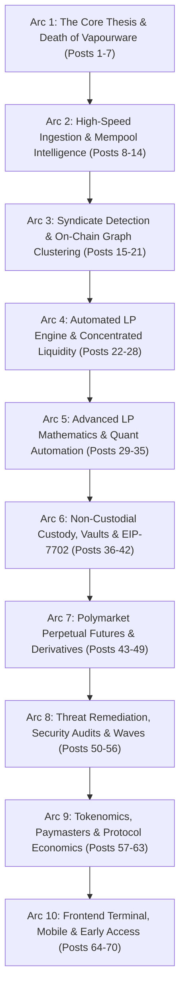

# WAKE Protocol — 70-Post Master Build Journey & Engineering Campaign for X (Twitter)

**A 10-Week Quantitative & Engineering Master Campaign Designed for High-Signal Crypto Twitter / X Presence Growth**

- **Document Version:** 1.0.0
- **Campaign Scope:** 70 Posts across 10 Thematic Arcs (7 Posts per Arc)
- **Target Audience:** DeFi Power Users, On-Chain Quants, MEV Researchers, Smart Contract Engineers, Alpha Hunters, and Quantitative Liquidity Providers
- **Tone:** Builder-centric, technically rigorous, proof-of-work focused, anti-vapourware, and mathematically precise
- **Format:** Hook + Primary Tweet Copy + Thread Continuation + Visual Asset Brief + Algorithmic Engagement Prompt

---

## Campaign Calendar & Strategic Framework



---

# ARC 1: The Core Thesis & The Death of Vapourware (Posts 1–7)

### Post 1: The Wake Protocol Manifesto
- **Theme:** Announcement / Vision
- **Hook:** Most crypto alert channels are graveyards for your capital. Here is why.
- **Tweet Copy:**
```text
Most Telegram signal bots are graveyards for your capital.

By the time an alert pings your phone:
1. The insider accumulated at block 0
2. Toxic MEV bots sandwiched the liquidity
3. You buy the exact top of the candle

Alerts are passive. What DeFi actually demands is immediate, non-custodial execution.

Enter Wake Protocol. 🧵👇
```
- **Thread Tweet:**
```text
We spent the last few months engineering Wake Protocol from the bare metal up:
• Multi-chain ingestion across Solana, Robinhood Chain, & Polymarket
• Cluster intelligence that flags coordinated syndicates
• Zero-custody execution rails via Anchor PDAs & EIP-7702

Here is how we built it. 🛠️
```
- **Visual Asset:** High-contrast graphic showing "Alert Ping (T+45s) = REXKT" vs "Wake Direct Execution (T+400ms) = FILLED".
- **Engagement Prompt:** "Do you still trade off Telegram alert bots? How much slippage are you eating on average?"

---

### Post 2: Solving Line-Speed (PostgreSQL BRIN vs B-Tree)
- **Theme:** Deep Systems Engineering
- **Hook:** How do you index 100,000,000+ on-chain transactions without setting your database on fire?
- **Tweet Copy:**
```text
How do you query 100,000,000+ on-chain transactions in milliseconds without choking your DB?

Standard B-Trees inflate to 40GB+ and eat all your server RAM.

For Wake Protocol, we deployed PostgreSQL BRIN (Block Range Indexing) on block timestamps alongside Redis 7.4 streams.

The result:
⚡ 98% index storage reduction
⚡ Sub-10ms range scans across months of mempool data
⚡ Zero worker starvation under peak Solana surges

Build for scale before you need it.
```
- **Thread Tweet:**
```text
Because on-chain transaction data is strictly append-only and physically ordered by block timestamp, BRIN indexes store only the minimum and maximum values per physical page range. 

Storage drops from 42GB to ~410MB. 

Hardware efficiency is an alpha feature.
```
- **Visual Asset:** Storage benchmark bar chart: B-Tree (42GB) vs BRIN (410MB) with execution time overlay.
- **Engagement Prompt:** "Postgres purists: what is your go-to indexing strategy for high-frequency time-series data?"

---

### Post 3: The Multi-Chain Ingestion Reality
- **Theme:** Architecture & Data Rails
- **Hook:** Alpha doesn’t respect ecosystem boundaries. Your execution engine shouldn't either.
- **Tweet Copy:**
```text
Alpha doesn’t stay on one chain. Your execution engine shouldn't either.

Most copy-trading tools are hardcoded to a single RPC on a single chain. 

Wake Protocol runs a unified cross-chain event pipeline across:
🔹 Solana (Jito bundles, Meteora DLMM, Raydium CLMM)
🔹 Robinhood Chain (EVM CLMM, EIP-7702 Account Abstraction)
🔹 Polymarket (Polygon CLOB binary outcome orderbooks)

One engine. Three distinct execution topologies. Zero fragmentation.
```
- **Thread Tweet:**
```text
Under the hood, all chain events normalize into a single internal lot attribution schema:
`TokenIn` + `TokenOut` + `PriceImpact` + `ExecutionVenue` + `SyndicateId`.

Whether it's a DLMM bin shift or an EVM tick traversal, the risk engine sees one unified format.
```
- **Visual Asset:** Clean architectural diagram showing Solana, Robinhood Chain, and Polymarket streaming into the Unified Lot Processor.
- **Engagement Prompt:** "Which chain currently holds the highest concentration of your trading capital?"

---

### Post 4: The 4-Tier Security Matrix
- **Theme:** Protocol Security
- **Hook:** 95% of DeFi protocols get hacked because they treat security as an audit checkmark before launch.
- **Tweet Copy:**
```text
95% of DeFi protocols get hacked because they treat security as an audit checkmark before launch.

At Wake Protocol, we built a 4-Tier Security Matrix directly into our CI/CD pipeline:
1. Static Analysis (Banned unsafe deserialization & raw eval)
2. Cryptographic Grant Invariants (Check constraints on key kinds)
3. Dynamic Invariant Fuzzing (Simulating 5,000 rebalances)
4. Offline Air-Gapped Test Qualification (180+ deterministic tests)

Code that moves money must prove its correctness mathematically.
```
- **Thread Tweet:**
```text
Our SQL migrations are strictly linear (001 through 087). 
Every grant table enforces `chk_ueg_secret_matches_kind` so unsealed credentials can never exist on disk or in RAM.

Paranoia is a prerequisite in DeFi.
```
- **Visual Asset:** Terminal output of 180 clean green tests running in `tests/qualification/wave4`.
- **Engagement Prompt:** "What is the biggest red flag you look for before depositing funds into a new protocol?"

---

### Post 5: Non-Custodial Account Abstraction
- **Theme:** Non-Custodial Invariants
- **Hook:** Never hand your private keys to a trading bot. Ever.
- **Tweet Copy:**
```text
Rule #1 of crypto: Not your keys, not your coins.

Yet, thousands of traders paste their private keys into Telegram bot databases every single day. 

When that server leaks, your entire net worth is drained in 1 block.

Wake Protocol is 100% non-custodial:
🛡️ EVM: EIP-7702 delegation to scoped session keys
🛡️ Solana: Anchor Program Derived Addresses (PDAs)

We execute trades on your behalf. We can NEVER withdraw your funds.
```
- **Thread Tweet:**
```text
Under EIP-7702, your wallet authorises our session key to execute ONLY predefined functions (`swap`, `rebalance`, `harvest`). 

If our servers were seized tomorrow, your principal remains safely inside your own wallet.
```
- **Visual Asset:** Side-by-side comparison: Telegram Bot (Custodial Private Key in DB) vs Wake Protocol (Scoped Session Key with Withdrawal Block).
- **Engagement Prompt:** "Have you ever audited what permissions you grant when using third-party copy bots?"

---

### Post 6: Master Attributed Inventory
- **Theme:** Risk Engine
- **Hook:** "PnL screenshots" are easy to fake. On-chain balance deltas are impossible to forge.
- **Tweet Copy:**
```text
"PnL screenshots" are easy to fake. On-chain balance deltas are impossible to forge.

In Wake Protocol, we built the Master Attributed Inventory system.

Every copy trade or LP rung tracks:
📊 Realized net execution slippage
📊 Gas paid vs gas sponsored by paymaster
📊 Impermanent loss calculated per block
📊 Time-weighted inventory drift

If a trade made 15% on paper but lost 4% to toxic routing and gas, we show you the brutal truth.
```
- **Thread Tweet:**
```text
True trader edge comes from accounting sincerity. 
Our ledger evaluates `netLpResult`:
`FeesEarned + InventoryChange - IL - Gas - RebalanceSlippage`.

No hidden costs. No vanity numbers.
```
- **Visual Asset:** Screenshot of the Wake Protocol Net LP breakdown ledger showing exact gas, fees, and IL balance.
- **Engagement Prompt:** "How do you calculate your real net PnL after DEX gas and slippage?"

---

### Post 7: 1,500+ Tests Before Launch
- **Theme:** Build Philosophy
- **Hook:** We didn't launch a token. We didn't buy influencers. We wrote 1,500 tests.
- **Tweet Copy:**
```text
We didn't launch a hype token.
We didn't buy influencer promo threads.

We spent months writing:
🧪 847 tests for `@swat/db`
🧪 451 tests for `@swat/shared`
🧪 180 tests for `@swat/lp`
🧪 124 integration test suites covering cross-chain failover

Software that manages automated liquidity cannot have "oopsie" moments on mainnet.

Build right. Build once.
```
- **Thread Tweet:**
```text
Every PR must pass clean on pinned 2-core environments, ensuring zero memory leaks or async event race conditions under production hardware constraints.

Here is what the full suite looks like in action. 👇
```
- **Visual Asset:** Vitest terminal run showing 1,500+ tests passing with zero failures.
- **Engagement Prompt:** "Builders: what is your test coverage threshold before touching mainnet capital?"

---

# ARC 2: High-Speed Ingestion & Mempool Intelligence (Posts 8–14)

### Post 8: Sub-50ms Solana Geyser Ingestion
- **Theme:** Solana Infrastructure
- **Hook:** If your Solana bot is relying on public HTTP RPCs, you are trading on yesterday's news.
- **Tweet Copy:**
```text
If your Solana bot is polling standard HTTP RPCs, you are trading on yesterday's news.

In high-volatility Solana slots, standard `getProgramAccounts` calls fail or lag by 2-5 seconds.

Wake Protocol pipes directly into Solana Geyser gRPC streams:
⚡ Sub-50ms transaction deserialization
⚡ Zero polling overhead
⚡ Immediate bin state reconstruction for Meteora DLMM

The moment a whale swaps, our risk engine has already attributed the lot.
```
- **Thread Tweet:**
```text
By bypassing the JSON-RPC serialisation layer and decoding raw byte buffers off the wire, we cut processing latency by over 80%. 

Speed isn't for flexing—it's to prevent getting sandwiched by Jito searchers.
```
- **Visual Asset:** Flamegraph showing JSON-RPC deserialization (80ms) vs Raw Geyser protobuf decode (8ms).
- **Engagement Prompt:** "What gRPC provider do you trust most for high-frequency Solana feeds: Helius, Triton, or self-hosted?"

---

### Post 9: Decoding EVM Tick Bitmaps in Real-Time
- **Theme:** EVM CLMM Mechanics
- **Hook:** Concentrated liquidity on EVM isn't just a swap curve—it's a massive linked list of tick bitmaps.
- **Tweet Copy:**
```text
Concentrated liquidity on EVM isn't just a swap curve. 

It's a sparse linked list of 256-bit words storing signed `liquidityNet` values across thousands of ticks.

When price rips through 50 ticks in a single block, how do you track active liquidity?

Wake Protocol walks the tick bitmap natively using bitwise shift operators in memory.

We know exact liquidity depth before submitting a rebalance.
```
- **Thread Tweet:**
```text
Instead of spamming `ticks(i)` RPC calls, we fetch the `tickBitmap` word with one multicall and compute bit-scans with `ctz` (count trailing zeros).

Result: 1 RPC call instead of 40. Zero rate-limit penalties.
```
- **Visual Asset:** Code snippet of bitwise tick walk logic (`tickBitmap >> bitPos`) alongside visual tick ladder.
- **Engagement Prompt:** "Uniswap v3 math experts: what's the cleanest way you've found to handle tick boundary transitions?"

---

### Post 10: Meteora DLMM Bin Array Math (Q64.64)
- **Theme:** Solana DLMM Mechanics
- **Hook:** Why did Meteora DLMM revolutionize Solana liquidity? It solved slippage with discrete price bins.
- **Tweet Copy:**
```text
Why is Meteora DLMM so powerful? 

Unlike Uniswap v3 where liquidity is continuous across ticks, Meteora discretizes capital into zero-slippage Bin Arrays.

Inside a single bin:
🎯 Zero price impact for intra-bin swaps
🎯 Pure fixed-point Q64.64 mathematical precision
🎯 Dynamic volatility fees that scale with market panic

Wake Protocol reconstructs these Bin Arrays on every slot.
```
- **Thread Tweet:**
```text
Our engine parses `LbPair` accounts and watches active bin IDs shift in real time. 
When market volatility spikes, Meteora's variable fee accumulator pumps fee yield up to 10x. 

We position your liquidity right where the volume lands.
```
- **Visual Asset:** Diagram illustrating continuous Uniswap v3 curve vs discrete Meteora DLMM zero-slippage bin boxes.
- **Engagement Prompt:** "Have you provided liquidity on Meteora DLMM? What bin distribution (Spot, Curve, Bid-Ask) do you prefer?"

---

### Post 11: Raydium CLMM Tick-Walking & Fee Accumulators
- **Theme:** Solana Raydium Integration
- **Hook:** Raydium CLMM handles billions in volume, but tracking fee growth per pool requires navigating complex accumulator state.
- **Tweet Copy:**
```text
Raydium CLMM processes billions in volume, but tracking real-time uncollected fees is notoriously tricky.

To calculate fee growth outside a position, you have to track:
📈 `feeGrowthGlobal0X64`
📈 `feeGrowthOutside0X64` below lower tick
📈 `feeGrowthOutside0X64` above upper tick

Wake Protocol tracks fee accumulators per block so you know your exact accrued dollar yield without submitting a harvest tx.
```
- **Thread Tweet:**
```text
This enables our engine to evaluate the "$2.10 Compounding Rule": 
We never trigger an auto-compound transaction until the real accrued fees surpass the break-even cost of the network gas.
```
- **Visual Asset:** Infographic breaking down the 3-part Fee Growth Outside formula on concentrated AMMs.
- **Engagement Prompt:** "What percentage of your LP returns usually gets eaten up by manual harvest fees?"

---

### Post 12: Polymarket CLOB WebSocket Ingestion
- **Theme:** Prediction Market Feeds
- **Hook:** Prediction markets are the fastest growing asset class in crypto. How do you stream their orderbooks at line-speed?
- **Tweet Copy:**
```text
Prediction markets are exploding. But trading them with slow REST APIs will get you front-run every time.

Wake Protocol built a dedicated WebSocket streamer for Polymarket's Central Limit Order Book (CLOB):
📡 Real-time level-2 book snapshots
📡 Instant binary outcome price tracking (Yes / No)
📡 Spread and market depth calculation across election & crypto contracts

Arbitraging real-world events requires millisecond execution.
```
- **Thread Tweet:**
```text
Our ingestion service maps binary token IDs (`token0 = Yes`, `token1 = No`) directly into our risk engine. 

When spot crypto moves, our algorithms can hedge synthetic prediction exposure before the manual crowd even loads the UI.
```
- **Visual Asset:** Live Polymarket Level 2 orderbook visualizer showing bids/asks streaming in real time.
- **Engagement Prompt:** "Are you trading Polymarket prediction markets? Which category has your biggest volume?"

---

### Post 13: RPC Failover Architecture
- **Theme:** Fault-Tolerant Infrastructure
- **Hook:** What happens to your automated trading bot when your primary RPC drops 15% of packets during a Solana meme mania?
- **Tweet Copy:**
```text
What happens to your trading bot when your primary RPC drops 15% of packets during market mania?

Most bots crash or freeze.

Wake Protocol uses an intelligent 3-Tier Dynamic Failover Router:
🟢 Tier 1: Dedicated private nodes (Helius / QuickNode)
🟡 Tier 2: Redundant public fallbacks with exponential backoff
🔴 Tier 3: Circuit-breaker health scoring that reroutes requests in <10ms

Zero dropped transactions. Zero orphaned positions.
```
- **Thread Tweet:**
```text
Every outbound RPC request is monitored for latency jitter, HTTP 429 rate limits, and block-height lag. 

If Node A lags behind Node B by even 2 slots, Node A is demoted instantly.
```
- **Visual Asset:** Node health dashboard graphic displaying automatic traffic rerouting during a simulated RPC crash.
- **Engagement Prompt:** "How many times has an RPC outage cost you an entry or an exit during high volatility?"

---

### Post 14: Redis 7.4 Streams & Event Idempotency
- **Theme:** Event-Driven Architecture
- **Hook:** In financial software, processing a trade event twice is an unforgivable bug.
- **Tweet Copy:**
```text
In financial software, processing a deposit or trade event twice is an unforgivable sin.

How do we guarantee exact-once execution across a cluster of background workers?

Wake Protocol uses Redis 7.4 Streams with Consumer Groups:
🔒 Unique deterministic idempotency keys per on-chain tx hash
🔒 Explicit ACK/NACK message delivery verification
🔒 Automatic dead-letter queues for unparseable payloads

Scale horizontally with zero double-spends.
```
- **Thread Tweet:**
```text
If a worker crashes halfway through a rebalance calculation, the unacknowledged message stays in the Pending Entries List (PEL). 

Another worker claims it after 500ms and verifies the on-chain state before executing. Fault-tolerance by design.
```
- **Visual Asset:** Mermaid sequence diagram illustrating Redis Stream Consumer Groups with ACK/PEL error recovery.
- **Engagement Prompt:** "What messaging layer powers your backend: Kafka, RabbitMQ, or Redis Streams?"

---

# ARC 3: Syndicate Detection & On-Chain Graph Clustering (Posts 15–21)

### Post 15: The Syndicate Detection Problem
- **Theme:** Smart Money Analysis
- **Hook:** That "genius wallet" you are copy-trading might just be 1 of 50 wallets owned by the same insider.
- **Tweet Copy:**
```text
That "genius 95% win-rate wallet" you are copy-trading?

It's probably 1 of 50 wallets operated by the same insider syndicate.

They buy across 20 wallets, pump with 10, and dump through 20 others. 

If you copy the wrong wallet, you become their exit liquidity.

Wake Protocol built on-chain Graph Clustering to unmask coordinated wallet rings before you follow them. 🧵👇
```
- **Thread Tweet:**
```text
We don't look at individual wallet addresses in isolation. We map the entire fund flow topology:
Who funded the gas?
Where did the proceeds route?
Did they execute in the exact same block?

Spot the syndicate, avoid the dump.
```
- **Visual Asset:** 2D Graph visualizer showing 30 disparate wallets clustered together around a single central funding node.
- **Engagement Prompt:** "Have you ever been burned by copy-trading a wallet that suddenly dumped on you?"

---

### Post 16: Louvain Community Detection on Fund Flows
- **Theme:** Graph Theory & Machine Learning
- **Hook:** How do you mathematically cluster 10,000 wallets into distinct syndicate groups? Graph theory.
- **Tweet Copy:**
```text
How do you group 10,000 separate crypto wallets into distinct insider teams?

Graph Theory.

Wake Protocol implements the Louvain Community Detection algorithm directly on transaction graphs:
🕸️ Nodes = Wallet addresses
🕸️ Edges = Fund transfers, split payments, common deposit addresses
🕸️ Weights = Volume and temporal proximity

When modularity peaks, the cluster reveals the hidden syndicate.
```
- **Thread Tweet:**
```text
Even when dev teams use mixers, coin splitters, or sub-wallets, the temporal signature of their deployments creates unmistakable mathematical clustering.

We turn chaotic blockchain ledgers into organized syndicate maps.
```
- **Visual Asset:** Graph clustering diagram showing modularity grouping disparate wallet addresses into color-coded clusters.
- **Engagement Prompt:** "Data scientists: what's your preferred graph algorithm for anomaly detection in blockchain data?"

---

### Post 17: Early Buyer Discovery vs. Bundled Snipers
- **Theme:** Mempool & Sniper Analysis
- **Hook:** Not all early buyers are smart money. 90% are bundled bot snipers dumping in the next block.
- **Tweet Copy:**
```text
Seeing a wallet buy in block 0 doesn't mean they're a genius.

90% of block-0 transactions are:
❌ Developer liquidity snipers
❌ Jito-bundled MEV front-runners
❌ Wash-trading volume bots

Wake Protocol's Early Buyer Discovery separates predatory snipers from genuine smart money:
✅ Scans historical wallet longevity
✅ Checks source of funds (CEX vs stealth contract)
✅ Tracks average holding duration

Copy the diamond hands, not the snipers.
```
- **Thread Tweet:**
```text
If a wallet's median holding duration is under 12 seconds, our copy engine automatically blacklists it from the smart-money leaderboard. 

We protect you from front-running yourself into instant losses.
```
- **Visual Asset:** Infographic comparing "Predatory Sniper" (Hold time: 4s, CEX drain) vs "Smart Money" (Hold time: 48h, Organic fund trail).
- **Engagement Prompt:** "What metrics do you look for before deciding to follow a new wallet?"

---

### Post 18: The Trader Scorer Metric
- **Theme:** Quantitative Trader Evaluation
- **Hook:** Stop looking at "Total Profit". It's the most misleading metric in crypto trading.
- **Tweet Copy:**
```text
Stop looking at "Total Profit" when picking traders to copy.

A trader who made $500,000 on one lucky 100x meme coin could lose your entire bankroll tomorrow.

Wake Protocol scores traders using institutional quant metrics:
📐 Sortino Ratio (Downside deviation penalty)
📐 Calmar Ratio (Annual return vs max drawdown)
📐 Win/Loss Profit Factor
📐 Tail-risk loss severity

We rank consistency, not lottery tickets.
```
- **Thread Tweet:**
```text
Our internal Trader Score normalizes performance across market regimes. 
A trader who consistently generates +25% monthly with a 4% max drawdown ranks far higher than a degen who swings +/- 80%.

Safety first. Compounding second.
```
- **Visual Asset:** Clean Trader Profile Card displaying Sortino, Max Drawdown, Profit Factor, and overall Wake Score badge.
- **Engagement Prompt:** "What's more important to you: a 200% volatile return or a steady 40% low-drawdown yield?"

---

### Post 19: The 7 Heuristic Filters for Wash Trading
- **Theme:** Anti-Fraud Architecture
- **Hook:** Over 60% of volume on new DEX tokens is fabricated by wash-trading bots. Here's how we filter them.
- **Tweet Copy:**
```text
Over 60% of trading volume on newly launched DEX pairs is fake.

Devs create 10 wallets, swap tokens back and forth in circles, and trick charting tools into showing "Hot Momentum".

Wake Protocol runs 7 Real-Time Heuristic Filters:
1. Zero-net-inventory cycles
2. Self-funding loop detection
3. Micro-second round-trip intervals
4. Uniform transaction sizing
5. Single-block swap backruns
6. Non-economic gas burns
7. Contract authority tampering

We filter out the fake volume so your bots only trade real demand.
```
- **Thread Tweet:**
```text
If a pool's volume is flagged as >40% wash-traded by our filters, its Fee Density score is marked invalid. 

We never deploy your hard-earned capital into artificial volume traps.
```
- **Visual Asset:** Diagnostic table showing 7 heuristic checks flagging an artificial volume pump.
- **Engagement Prompt:** "Have you ever bought into a token only to realize the volume was 100% bots trading with themselves?"

---

### Post 20: Real-Time Copy Trade Intent Generation
- **Theme:** Trade Execution Architecture
- **Hook:** Copy-trading isn't "see a swap, send a swap". Doing that guarantees you buy worse prices every time.
- **Tweet Copy:**
```text
Copy-trading isn't just:
"See wallet A swap -> Send identical swap".

If you do that, you get sandwich-attacked, pay double slippage, and buy at worse prices every single time.

Wake Protocol generates smart Copy Trade Intents:
🎯 Lot-proportional sizing (calibrated to YOUR bankroll)
🎯 Dynamic slippage caps based on pool depth
🎯 Private mempool submission (Jito bundles on Solana, Flashbots on EVM)

Copy the alpha without paying the copy-trader penalty.
```
- **Thread Tweet:**
```text
If the target whale buys with $50,000 in a thin pool causing 8% slippage, our engine refuses to market-buy behind them. 

Instead, it evaluates whether to place a limit order or wait for the inevitable retrace. Precision execution.
```
- **Visual Asset:** Execution sequence comparison: Naive Copy Bot (Gets sandwiched) vs Wake Intent Engine (Private bundle execution).
- **Engagement Prompt:** "What's the worst slippage you've ever experienced while trying to copy a fast trade?"

---

### Post 21: Machine Learning Anomaly Detection (`pattern-ml`)
- **Theme:** AI / ML Integration
- **Hook:** How do you catch rug pulls before the liquidity is pulled? Pattern recognition on mempool state.
- **Tweet Copy:**
```text
How do you detect a rug pull before the liquidity is removed?

Code inspection alone isn't enough—malicious devs hide backdoors in bytecode.

Wake Protocol uses our `@swat/pattern-ml` package to monitor real-time order-flow anomalies:
🧠 Detecting sudden liquidity concentration shifts
🧠 Flagging abnormal creator wallet mint calls
🧠 Predicting sell cascades before block confirmation

Machine learning trained on 50,000+ historical DEX exploits.
```
- **Thread Tweet:**
```text
When anomalous patterns cross our risk threshold, the engine immediately initiates an atomic emergency unwind—pulling your position before the pool collapses.

Defense at the speed of code.
```
- **Visual Asset:** Anomaly detection score graph showing the exact moment the model flagged an exploit before liquidity was pulled.
- **Engagement Prompt:** "Do you believe AI/ML has a permanent edge in detecting on-chain smart contract exploits?"

---

# ARC 4: The Automated LP Engine & Concentrated Liquidity (Posts 22–28)

### Post 22: The Retail LP Dilemma
- **Theme:** Concentrated Liquidity Reality
- **Hook:** 85% of concentrated liquidity providers on Uniswap v3 and Meteora lose money. Why?
- **Tweet Copy:**
```text
Providing concentrated liquidity on Uniswap v3 or Meteora is mathematically hostile to retail traders.

Over 85% of retail LPs end up with NET NEGATIVE returns compared to just holding the tokens.

Why?
⚠️ Unhedged Impermanent Loss
⚠️ Constant out-of-range position drift
⚠️ Hyperactive rebalancing that burns all profit on gas & swap fees

Concentrated LP is full-time quantitative trading. 

Wake Protocol automates it so you can earn passive fees without the headache. 🧵👇
```
- **Thread Tweet:**
```text
Most interfaces ask users to configure 20+ fine-grained sliders: ticks, curves, slippage, rebalance thresholds, stop-losses.

One wrong click and your liquidity gets wiped out by a single red candle. 

There has to be a better way.
```
- **Visual Asset:** Chart showing "Naive Retail LP vs HODL Benchmark" with the retail line diving into negative territory.
- **Engagement Prompt:** "Have you ever lost money providing concentrated liquidity? What was the biggest reason?"

---

### Post 23: 1-Click Battle-Tested Strategy Presets
- **Theme:** UX & Product Innovation
- **Hook:** We threw away the 20 complex sliders. Introducing 1-Click Battle-Tested LP Presets.
- **Tweet Copy:**
```text
We threw away the 20 complex sliders.

You shouldn't need a PhD in financial engineering just to provide liquidity in DeFi.

Wake Protocol introduces 1-Click Battle-Tested LP Presets:
1️⃣ Native Accumulator (Conservative / Pegged & Correlated)
2️⃣ Patient Yield Farmer (Balanced / The PAMAN Standard)
3️⃣ Alpha Momentum Runner (Aggressive / High-Fee Spikes)

Select your archetype. Input your deposit. Click approve. 

The quant engine handles the rest.
```
- **Thread Tweet:**
```text
Under the hood, each preset dynamically configures tick widths, anti-churn delays, emergency circuit breakers, and zero-gas auto-compounding schedules.

Simplicity on the outside. Institutional engineering on the inside.
```
- **Visual Asset:** UI mockup of the 3 Preset Cards on the Wake Protocol Dashboard with clean APY and risk ratings.
- **Engagement Prompt:** "Would you prefer 1-click automated presets or manual slider control for your LP positions?"

---

### Post 24: Preset A — "Native Accumulator"
- **Theme:** Low-Risk Yield Strategies
- **Hook:** Want steady 10-22% APY on your ETH, SOL, or Stables with virtually ZERO impermanent loss risk?
- **Tweet Copy:**
```text
Want steady 10-22% APY on your ETH, SOL, or Stables with virtually ZERO impermanent loss?

Meet Preset A: "Native Accumulator".

Built for correlated and pegged pairs:
💎 `ETH / stETH`
💎 `SOL / JitoSOL`
💎 `USDC / USDT`

Features:
🛡️ Tight ±1.5% to ±3% range bands on pegged pairs
🛡️ 48-hour Anti-Churn lock to avoid fee drag
🛡️ Automated peg-break circuit breaker

Accumulate your favorite base assets while you sleep.
```
- **Thread Tweet:**
```text
Because these assets track each other 1:1, impermanent loss is practically non-existent. 
You capture concentrated trading fees from arbitrageurs and DEX aggregators without sweating market volatility.
```
- **Visual Asset:** Range diagram showing tight pegged band around 1.0000 with stable fee collection graph.
- **Engagement Prompt:** "What's your biggest yield-generating holding right now: stETH, JitoSOL, or pure stables?"

---

### Post 25: Preset B — "Patient Yield Farmer" (The PAMAN Standard)
- **Theme:** Core Battle-Tested Strategy
- **Hook:** How do Indonesian DeFi communities consistently earn 35-85% net APY on volatile pairs? The PAMAN Strategy.
- **Tweet Copy:**
```text
How do Southeast Asian DeFi communities consistently yield 35-85% net APY on volatile pairs?

We studied the legendary PAMAN quantitative framework and baked it directly into Preset B: "Patient Yield Farmer".

Designed for major bluechips: `ETH/USDC`, `SOL/USDC`, `ARB/USDC`.

Key Rules:
⚡ ±12% to ±18% dynamic range bands
⚡ 24-hour Incumbent Position Guard (zero panic rebalancing)
⚡ In-Pool Tick Re-Centering (never market-dump your assets)

Discipline beats emotion. Every single time.
```
- **Thread Tweet:**
```text
When price drifts out of range, the engine doesn't panic. 
It gives the position 24 hours to mean-revert. 
If it stays out, it recalculates the tick ladder inside the pool without selling tokens at a loss.
```
- **Visual Asset:** Flowchart showing PAMAN range logic: Active -> Near Edge -> 24h Observation -> In-Pool Re-Centering.
- **Engagement Prompt:** "Have you heard of the PAMAN framework or Krystal auto-farm vaults before?"

---

### Post 26: Preset C — "Alpha Momentum Runner"
- **Theme:** High-Risk High-Reward Yield
- **Hook:** When a meme coin or new ecosystem token pumps 500% in a week, who makes the real money? The concentrated LPs.
- **Tweet Copy:**
```text
When a new token does 500% in a week, trading it is a casino gamble.

The real winners? The concentrated liquidity providers harvesting 200-400% annualized fees from the trading frenzy.

Preset C: "Alpha Momentum Runner":
🔥 Tight ±4% to ±8% concentrated bands
🔥 Dynamic trend-following skew (+3% bias with 4h EMA)
🔥 Fast auto-compounding every 2 hours
🔥 Strict 8% hard stop-loss circuit breaker

Harvest peak volatility. Exit before the party ends.
```
- **Thread Tweet:**
```text
This archetype is engineered for high-fee density pools (`Fee24h / TVL >= 1.0%`). 
It rides the momentum wave while the volume is scorching, then auto-unwinds the moment volume drops by 50%.
```
- **Visual Asset:** Chart showing tight momentum band tracking an upward price breakout with rapid fee accumulation.
- **Engagement Prompt:** "Would you deploy capital into an aggressive momentum LP preset during a meme run?"

---

### Post 27: The "Fee-Truth" Scorer (Rejecting Fake APRs)
- **Theme:** Data Transparency & Honesty
- **Hook:** That DEX showing "1,840% APR" is almost certainly lying to you. Here's the math.
- **Tweet Copy:**
```text
That DEX pool showing "1,840% APR" is almost certainly lying to you.

Standard DEX interfaces take a 15-minute volume spike from a single trade, annualize it by 365 days, and display a fake 4-digit yield.

Wake Protocol built the "Fee-Truth" Scorer:
$$\text{Fee Density}_{24\text{h}} = \frac{\text{Actual 24h Fees}}{\text{Pool TVL}}$$

Our Hard Quality Gates:
✅ Fee Density $\ge 0.60\%$ (real sustainable volume)
✅ 24h Volume / TVL $\ge 0.25x$
✅ Minimum TVL floor of $50,000

We protect you from fake yield traps.
```
- **Thread Tweet:**
```text
If a pool has $10M in TVL but only did $1,000 in fees yesterday, its Fee Density is 0.01% (garbage). 
Our scanner automatically blacklists it, no matter what flashy number the front-end claims.
```
- **Visual Asset:** Graphic contrasting "Fake DEX APR (1,840%)" with "Wake Real Fee Density Score (0.12% - Disqualified)".
- **Engagement Prompt:** "What's the highest fake APR you've ever fallen for in DeFi?"

---

### Post 28: Incumbent Position Protection (Anti-Churn Guard)
- **Theme:** Execution Optimization
- **Hook:** The number one reason automated LP bots go broke: hyperactive rebalancing.
- **Tweet Copy:**
```text
The #1 reason automated LP bots bleed capital:
Hyperactive rebalancing.

Every time a bot adjusts a range, you pay:
💸 DEX swap fee (0.3% - 1.0%)
💸 Price impact slippage
💸 Network gas fees

Rebalance 5 times a day and you've burned 3% of your principal in friction.

Wake Protocol enforces Incumbent Position Protection:
No position is rebalanced if it's younger than 24-48 hours.

Let your liquidity earn back its entry toll before you move it.
```
- **Thread Tweet:**
```text
Positions must earn enough fees to mathematically outpace rebalance friction before any voluntary adjustment is authorized. 

Only a verified Emergency Circuit Breaker can override this guard.
```
- **Visual Asset:** Math comparison: Bot A (Rebalances every 2 hours = -4.2% net) vs Wake (24h Churn Guard = +11.8% net).
- **Engagement Prompt:** "How often does your current liquidity manager rebalance your positions?"

---

# ARC 5: Advanced LP Mathematics & Quant Automation Rails (Posts 29–35)

### Post 29: In-Pool Re-Centering vs. Panic Liquidation
- **Theme:** Impermanent Loss Mitigation
- **Hook:** When price dumps outside your LP range, naive bots make the worst mistake possible: they sell everything to USD at the bottom.
- **Tweet Copy:**
```text
When price dumps below your LP range, naive bots make the worst mistake possible:

They market-sell all your depreciated tokens into USD at the exact bottom.

Congratulations—you just permanently crystallized 100% of your Impermanent Loss.

Wake Protocol uses In-Pool Tick Re-Centering:
We keep your token inventory intact. 
We shift the concentrated liquidity band around the new price INSIDE the pool.

You keep harvesting high fees, allowing mean-reversion to recover the drift.
```
- **Thread Tweet:**
```text
Selling assets at the lowest point of a volatility wick is peak retail behavior. 

Our quant engine preserves the inventory ratio and deploys fresh rungs to capture the bounce.
```
- **Visual Asset:** Diagram comparing "Panic Sell to Cash (IL Locked)" vs "Wake In-Pool Re-Centering (Earning Fees on the Rebound)".
- **Engagement Prompt:** "Have you ever had an automated vault dump your tokens at the bottom of a crash?"

---

### Post 30: The Native Asset Benchmark Hurdle
- **Theme:** Quant Performance Benchmarking
- **Hook:** If your ETH/USDC pool gained 20% in USD while ETH gained 40%, you didn't win. You lost.
- **Tweet Copy:**
```text
If your ETH/USDC pool gained 20% in USD while ETH gained 40%, you didn't win. 

You lost 20% of your potential wealth to Impermanent Loss.

Most protocols hide behind USD charts during a bull market.

Wake Protocol reports the Native Asset Benchmark Hurdle:
$$\alpha_{\text{LP}} = \Delta V_{\text{LP}} - \Delta V_{\text{HODL\_Benchmark}}$$

If your net LP returns don't beat simply holding the base assets, we flag it in red.

Real alpha, zero deception.
```
- **Thread Tweet:**
```text
Our dashboard shows a real-time dual-line chart:
Blue line = Your active Wake LP position.
Dotted line = What you would have had if you just kept the tokens in cold storage.

If we aren't beating HODL, we haven't done our job.
```
- **Visual Asset:** Dual-line chart showing Wake LP outperforming the HODL benchmark line through fee accumulation.
- **Engagement Prompt:** "Do you track your LP returns against a HODL benchmark or just in USD?"

---

### Post 31: The $2.10 Fee Floor Compounding Rule
- **Theme:** Micro-Economics of Gas
- **Hook:** Auto-compounding fees every 10 minutes sounds awesome—until you realize you spent $15 in gas to compound $2 in fees.
- **Tweet Copy:**
```text
Auto-compounding fees every 10 minutes sounds incredible on paper.

Until you realize you just spent $12 in gas to reinvest $3 in fees. 

You're literally donating your yield to network validators.

Wake Protocol enforces the "$2.10 Fee Floor Compounding Rule":
Accrued uncollected fees MUST surpass the mathematical break-even threshold of network execution before a harvest is triggered.

Compound when it makes money, not when it feeds validators.
```
- **Thread Tweet:**
```text
And on the Robinhood Chain, our EIP-7702 Paymaster sponsors the gas entirely—meaning small depositors ($100-$500) can compound with zero gas drag!
```
- **Visual Asset:** Fee compounding break-even curve displaying net yield vs gas cost over time.
- **Engagement Prompt:** "What's the minimum fee balance you wait for before claiming and compounding your LP yield?"

---

### Post 32: Dynamic Tick Band Construction
- **Theme:** Mathematical Modeling
- **Hook:** How do you convert a human strategy into mathematically valid Uniswap ticks and Meteora bins?
- **Tweet Copy:**
```text
How do you translate a strategy like "15% symmetric range" into on-chain reality?

On EVM:
Ticks are logarithmic: $P(i) = 1.0001^i$. 
You must align ticks to the pool's strict `tickSpacing` (e.g. 10, 60, 200).

On Solana Meteora:
Bins are linear Q64.64 steps centered around `activeId`.

Wake Protocol's `builder/templates.ts` maps continuous strategy archetypes into valid on-chain discrete ladder rungs in microseconds.
```
- **Thread Tweet:**
```text
Our ladder builder normalizes token decimals (e.g. 18-decimal WETH vs 6-decimal USDC) so tick rungs never suffer from decimal truncation errors. 

Precision at the byte level.
```
- **Visual Asset:** Code snippet demonstrating tick alignment and rounding to `tickSpacing` multiples.
- **Engagement Prompt:** "What was the hardest bug you encountered when first working with Uniswap v3 tick math?"

---

### Post 33: Flash Crash Circuit Breakers
- **Theme:** Risk Management
- **Hook:** In a flash crash, DEX prices can drop 25% in 3 minutes and bounce right back. If your bot rebalances, you get liquidated.
- **Tweet Copy:**
```text
During a flash crash, a DEX price can wick down 25% in 3 minutes and fully recover by minute 6.

If your automated LP bot tries to rebalance during that wick:
❌ It swaps at the worst possible price
❌ Toxic MEV searchers arbitrage your rebalance
❌ Price bounces back and you're left holding 100% stablecoins

Wake Protocol deploys Flash Crash Circuit Breakers:
If price velocity exceeds 15% in <5 minutes, all rebalancing halts for N blocks until volatility stabilizes.

Don't let market wicks liquidate your strategy.
```
- **Thread Tweet:**
```text
Volatility halts protect liquidity providers from becoming the liquidity exit for distressed liquidation cascades. 

Patience is a risk safeguard.
```
- **Visual Asset:** Graph showing a sharp flash crash wick with a "REBALANCE FROZEN" barrier preventing bad execution.
- **Engagement Prompt:** "Have you ever had a stop-loss trigger at the exact bottom tick of a wick?"

---

### Post 34: Active TVL Normalization Across Decimals
- **Theme:** Math & Accounting
- **Hook:** What happens when an algorithm divides an 18-decimal token by a 6-decimal token without exact scaling? Total system failure.
- **Tweet Copy:**
```text
What happens when a trading algorithm miscalculates decimal scaling between an 18-decimal token (WETH) and a 6-decimal token (USDC)?

Total accounting failure.

In concentrated AMMs, liquidity $L$ is scaled by $\sqrt{P}$. 
A decimal mismatch of $10^{12}$ causes the engine to miscalculate real active TVL by orders of magnitude.

Wake Protocol built decimal-normalized band scanners with USD-anchor verification.

Zero calculation drift across any token pair.
```
- **Thread Tweet:**
```text
Our test suite validates decimal conversions against live on-chain fixtures for WBTC (8 dec), USDC (6 dec), and DAI (18 dec) on every build.
```
- **Visual Asset:** Formula graphic showing decimal scaling factor: $10^{(\text{dec}_1 - \text{dec}_0) / 2}$ applied to $\sqrt{P}$.
- **Engagement Prompt:** "What token pair decimal quirk has caused you the most headaches in DeFi?"

---

### Post 35: Meteora Volatility Fee Accumulator
- **Theme:** Solana DLMM Mechanics
- **Hook:** In normal AMMs, high volatility destroys liquidity providers. In Meteora DLMM, it makes them rich.
- **Tweet Copy:**
```text
In traditional AMMs, violent volatility destroys liquidity providers through impermanent loss.

In Meteora DLMM, volatility is your biggest profit driver.

How? The Volatility Fee Accumulator.
Meteora dynamically scales the pool fee from 0.15% up to 2.5%+ whenever price transitions through bins rapidly.

Toxic flow pays a dynamic penalty that goes directly into YOUR pocket.

Wake Protocol positions your bins right in the path of the volatility surge.
```
- **Thread Tweet:**
```text
By dynamically compounding these surge fees back into the bin array before volatility subsides, your yield compounds at exponential velocity.
```
- **Visual Asset:** Bar chart showing baseline trading fees vs dynamic surge fees during a high-volatility event on Meteora.
- **Engagement Prompt:** "Do you prefer static fee tiers (like Uniswap 0.3%) or dynamic volatility fees?"

---

# ARC 6: Non-Custodial Custody, Vaults & EIP-7702 (Posts 36–42)

### Post 36: The Death of CEX-Style API Keys
- **Theme:** Custody & Security
- **Hook:** Giving a bot your private key or an API secret with withdrawal permissions is financial suicide.
- **Tweet Copy:**
```text
Giving a trading bot your private key or an unrestricted API key is financial suicide.

One compromised server.
One rogue employee.
One malicious dependency update.

And your funds are gone forever.

Wake Protocol completely eliminates CEX-style custody:
❌ No private keys in our database
❌ No master wallet pooling
❌ No withdrawal permissions

Your capital never leaves your personal custody. Period.
```
- **Thread Tweet:**
```text
We interact with your wallet using programmable account abstraction. 

We can execute strategy transactions within agreed parameters, but we can NEVER transfer assets to an unauthorized address.
```
- **Visual Asset:** Graphic displaying "HACK RESISTANT ARCHITECTURE": The server can be breached, but zero user funds can be stolen.
- **Engagement Prompt:** "How many crypto bots or platforms currently hold your private keys or full API secrets?"

---

### Post 37: EIP-7702 Deep Dive on Robinhood Chain
- **Theme:** Ethereum Improvement Proposals
- **Hook:** EIP-7702 is the biggest revolution in Ethereum account abstraction since ERC-4337. Here is why.
- **Tweet Copy:**
```text
EIP-7702 is the biggest upgrade to Ethereum account abstraction in history.

Historically, to use smart account features (gas sponsorship, batch transactions, session keys), you had to deploy a brand new smart contract wallet (Gnosis Safe, Kernel).

With EIP-7702:
Your EXISTING standard EOA wallet temporarily adopts smart contract capabilities for a transaction.

Wake Protocol uses EIP-7702 on the Robinhood Chain to deliver true zero-gas, non-custodial automation. 🧵👇
```
- **Thread Tweet:**
```text
You don't need to migrate funds to a new address. 
Your Metamask or Rabby wallet signs a single delegation authorization (`0x7702`), granting temporary execution rights to our session smart account.
```
- **Visual Asset:** Diagram showing standard EOA transforming into an EIP-7702 smart account with EntryPoint v0.7.
- **Engagement Prompt:** "Have you used an EIP-7702 delegated wallet yet? What was your experience?"

---

### Post 38: Scoped Session Keys & Transaction Boundaries
- **Theme:** Authorization & Cryptography
- **Hook:** How can you let an AI or automated engine trade for you without giving it permission to steal your money?
- **Tweet Copy:**
```text
How can you let an algorithm trade for you without giving it the power to steal your funds?

Scoped Session Keys.

When you connect your wallet to Wake Protocol, you sign an EIP-712 grant with strict cryptographic bounds:
🔒 Allowed Target Contracts: ONLY the verified DEX router
🔒 Allowed Selectors: ONLY `rebalance`, `swap`, `compound`
🔒 Banned Selectors: `transfer`, `approve` to external addresses
🔒 Hard Expiry: Automatically revokes after 30 days

Trust math, not promises.
```
- **Thread Tweet:**
```text
Even if our execution engine went completely rogue, the smart account contract would revert any transaction attempting to transfer tokens outside your wallet.
```
- **Visual Asset:** Visual breakdown of the EIP-712 permission struct showing allowed functions vs forbidden transfers.
- **Engagement Prompt:** "Would you be more comfortable automating trades if you knew withdrawals were physically blocked by smart contracts?"

---

### Post 39: Solana Anchor PDA Delegation
- **Theme:** Solana Smart Contract Architecture
- **Hook:** How do you achieve non-custodial delegation on Solana without smart accounts? Program Derived Addresses (PDAs).
- **Tweet Copy:**
```text
How do you achieve non-custodial delegation on Solana without EVM-style smart accounts?

Program Derived Addresses (PDAs).

Wake Protocol leverages Anchor PDAs:
1. You authorize a dedicated PDA derived from your wallet address and our program ID.
2. The PDA is authorized to reallocate DLMM bin positions.
3. The PDA has ZERO instruction authority to route tokens to any address other than your master wallet.

Zero-custody yields across every ecosystem.
```
- **Thread Tweet:**
```text
Seeds: `[b"vault", user_wallet.key().as_ref()]`. 
Only your wallet can trigger a complete withdrawal or revoke the PDA authority.
```
- **Visual Asset:** Solana account ownership architecture diagram illustrating the User Wallet -> PDA -> Meteora Vault relationship.
- **Engagement Prompt:** "Solana developers: what's your favorite security pattern when managing user-delegated PDAs?"

---

### Post 40: Envelope-Sealed Secrets (AES-256-GCM)
- **Theme:** Operational Security
- **Hook:** If a hacker dumps your PostgreSQL database, will they find session secrets in plain text?
- **Tweet Copy:**
```text
If a hacker dumps your database, will they find your users' session secrets?

At Wake Protocol, the answer is an absolute NO.

We built the `EnvMasterKeyWrapper`:
🔐 Every session credential is envelope-sealed using AES-256-GCM
🔐 Versioned encryption prefixes (`v1:nonce:ciphertext:tag`)
🔐 Hardware master keys kept entirely in memory, never written to disk

A database leak is just a pile of useless random bytes.
```
- **Thread Tweet:**
```text
Our SQL schema enforces check constraint `chk_ueg_secret_matches_kind`: 
The database physically rejects any attempt to insert an unsealed or unversioned credential.
```
- **Visual Asset:** Diagram illustrating Envelope Encryption: Master Key -> Data Encryption Key -> Encrypted Payload.
- **Engagement Prompt:** "Security teams: do you enforce database-level check constraints on encrypted secret formats?"

---

### Post 41: Database Check Constraints as Security Guards
- **Theme:** Database Defense-in-Depth
- **Hook:** Why do we put cryptographic security constraints inside PostgreSQL instead of just relying on TypeScript code?
- **Tweet Copy:**
```text
Why enforce security inside PostgreSQL when you already have TypeScript validation?

Because application code has bugs. Developers bypass helper functions. API routes get refactored.

Database constraints NEVER sleep.

Wake Protocol deploys database-level defense:
🛡️ `chk_ueg_secret_matches_kind`: Rejects invalid secret formats
🛡️ `chk_ueg_session_expires`: Rejects invalid expiration timestamps
🛡️ `chk_ueg_grant_revoked`: Enforces immutable revocation state

If the data violates safety rules, the database crashes the query.
```
- **Thread Tweet:**
```text
Defense in depth means never trusting a single layer of your stack. 
If the API fails, the DB stops the exploit.
```
- **Visual Asset:** SQL code snippet showing the `ALTER TABLE ... ADD CONSTRAINT` definition in migration 086.
- **Engagement Prompt:** "Do you rely entirely on ORM validation, or do you write strict SQL constraints in production?"

---

### Post 42: Instant One-Click On-Chain Revocation
- **Theme:** User Sovereignty
- **Hook:** If you want to disconnect from Wake Protocol, how long does it take? Exactly 1 block.
- **Tweet Copy:**
```text
What happens if you want to disconnect your wallet and stop all automated execution?

With centralized platforms, you submit a cancellation ticket, wait 48 hours, and pray they actually delete your API keys.

With Wake Protocol:
⚡ 1-Click On-Chain Revocation.
⚡ You broadcast a single transaction.
⚡ The delegation grant is severed immediately.

No permissions remain. Zero lingering access. Complete sovereignty.
```
- **Thread Tweet:**
```text
Even if our servers continue broadcasting rebalances, the blockchain nodes reject them instantly with an authorization error. 

You remain in complete control at all times.
```
- **Visual Asset:** UI screenshot showing the red "Instant Revoke All Grants" button and verified on-chain revocation modal.
- **Engagement Prompt:** "Have you ever had trouble revoking permissions from a DeFi dApp? How did you handle it?"

---

# ARC 7: Polymarket Perpetual Futures & Prediction Market Derivatives (Posts 43–49)

### Post 43: Why Prediction Markets Need Perps
- **Theme:** Prediction Markets & Derivatives
- **Hook:** Prediction markets are the ultimate truth machine. But their capital efficiency is broken.
- **Tweet Copy:**
```text
Prediction markets are the ultimate truth machine. 

So why aren't more institutions trading them?

Capital inefficiency.

On Polymarket, to buy $10,000 of an outcome, you must lock up $10,000 in USDC until resolution. 
Your capital is trapped for months.

Wake Protocol is building the first Perpetual Futures layer for Polymarket:
🚀 Up to 5x leverage on binary outcomes
🚀 Cross-margined synthetic collateral
🚀 Long or Short election & crypto predictions without locking principal

Welcome to Prediction Market 2.0. 🧵👇
```
- **Thread Tweet:**
```text
By wrapping Conditional Token Framework (CTF) shares into synthetic perpetual contracts, traders can express high-conviction views with fractional capital.
```
- **Visual Asset:** Infographic comparing "Spot Polymarket (1x, Locked 6 months)" vs "Wake Polymarket Perps (5x Leverage, Dynamic Margin)".
- **Engagement Prompt:** "Would you trade Polymarket outcomes with leverage if a secure perps platform existed?"

---

### Post 44: Synthetic Margin Architecture
- **Theme:** Margin & Collateral Mechanics
- **Hook:** How do you build cross-margined perpetuals on assets that physically expire to either $0 or $1?
- **Tweet Copy:**
```text
How do you build a cross-margin perp engine on binary outcome tokens that expire to either $0.00 or $1.00?

Traditional perp math (BTC/ETH) assumes infinite price boundaries. 
Binary outcome tokens are bounded in the range $[0, 1]$.

Wake Protocol designed a specialized Bounded Synthetic Margin Engine:
📊 Maintenance margin curves that scale as outcome probability approaches 0 or 1
📊 Portfolio cross-margining against opposing outcomes
📊 Real-time collateral rebalancing

Engineering derivatives for the prediction economy.
```
- **Thread Tweet:**
```text
If you hold YES on Candidate A and YES on Candidate B in an exclusive outcome set, your portfolio risk is inversely correlated. 

Our engine offsets margin requirements accordingly.
```
- **Visual Asset:** Margin curve graphic showing maintenance margin scaling dynamically across the $[0, 1]$ probability range.
- **Engagement Prompt:** "Derivatives quants: how would you structure liquidation thresholds for binary options?"

---

### Post 45: Dynamic Funding Rates on Binary Outcome Tokens
- **Theme:** Quantitative Derivatives
- **Hook:** How do you keep the price of a leveraged perp pegged to a prediction market share price? Dynamic Funding Rates.
- **Tweet Copy:**
```text
In crypto perps, funding rates balance long and short open interest against spot prices.

In prediction markets, outcomes have an expiry date. 
Time decay acts as a gravitational pull toward resolution.

Wake Protocol implements Time-Decay Calibrated Dynamic Funding Rates:
$$\text{Funding Rate} = \frac{\text{Perp Price} - \text{Polymarket Spot}}{\text{Time to Expiry}} + \text{Skew Penalty}$$

The closer to resolution, the tighter the peg.
```
- **Thread Tweet:**
```text
This prevents manipulative whales from artificially holding synthetic perps away from the underlying Polymarket orderbook. 

Arbitrageurs keep the market honest.
```
- **Visual Asset:** Chart showing perp price converging cleanly with spot price as resolution date approaches.
- **Engagement Prompt:** "What's the most extreme funding rate you've ever paid on a leveraged position?"

---

### Post 46: Liquidations Without Cascades (Dutch Auctions)
- **Theme:** Risk Engine & Liquidations
- **Hook:** The biggest danger in leveraged trading: liquidation cascades crashing the entire market into a death spiral.
- **Tweet Copy:**
```text
The biggest disaster in leveraged trading?
Liquidation cascades.

When one trader gets liquidated, the market-sell crashes the price, liquidating the next trader, in an endless death spiral.

Wake Protocol eliminates cascading liquidations on prediction perps using Dutch Auction Liquidations:
📉 Under-collateralized positions are auctioned gradually over time
📉 Liquidation discount starts at 1% and ticks down
📉 MEV liquidators compete for the best execution price

Zero market impact. Zero protocol bad debt.
```
- **Thread Tweet:**
```text
By avoiding instant market dumps into thin CLOB orderbooks, the protocol absorbs liquidation volume without triggering collateral contagion.
```
- **Visual Asset:** Step-down Dutch Auction price descent curve showing smooth liquidation fill without price impact.
- **Engagement Prompt:** "Which liquidation model is superior: Dutch auctions or instant backstop liquidator pools?"

---

### Post 47: Virtual AMM (vAMM) Curve Math
- **Theme:** Market Making Math
- **Hook:** What happens when an outcome market has high demand but zero liquidity providers? You use a Virtual AMM.
- **Tweet Copy:**
```text
What do you do when a niche prediction market has thousands of eager traders but zero liquidity providers?

Enter the Virtual AMM (vAMM).

Wake Protocol deploys constant-product virtual reserves $(x \times y = k)$:
Virtual reserves provide algorithmic price discovery without requiring real pooled counterparty assets. 
Real collateral sits safely inside the margin clearinghouse.

Trade any prediction market with zero counterparty wait times.
```
- **Thread Tweet:**
```text
Virtual reserves adjust dynamically based on open interest skew, ensuring the protocol is never exposed to directional inventory risk.
```
- **Visual Asset:** Formula and diagram of the vAMM clearinghouse model: Real Margin Vault <-> Virtual Reserve Engine.
- **Engagement Prompt:** "Did you trade during the original Perpetual Protocol v1 vAMM era? What were the key lessons?"

---

### Post 48: CTF (Conditional Token Framework) Adapter
- **Theme:** Smart Contract Adapters
- **Hook:** Polymarket runs on Gnosis Conditional Token Framework (CTF). How do you interface with it programmatically?
- **Tweet Copy:**
```text
Polymarket's underlying infrastructure runs on Gnosis' Conditional Token Framework (CTF) on Polygon.

Interacting with CTF requires navigating:
🧩 `CollectionId` generation from question hashes
🧩 `PositionId` calculation from condition IDs
🧩 Binary outcome split & merge operations

Wake Protocol built a custom CTF Exchange Adapter in our trade-executor package:
Direct on-chain split, trade, and redeem in a single atomic bundle.
```
- **Thread Tweet:**
```text
When a prediction market resolves, our adapter immediately claims the $1.00 payout on-chain and distributes the settled collateral back to your account.
```
- **Visual Asset:** Architectural flow: Question Hash -> Condition ID -> Split Shares -> Perp Settlement -> Redeem USDC.
- **Engagement Prompt:** "Have you built smart contracts interacting with Gnosis Conditional Tokens before?"

---

### Post 49: Risk Guardian for Perps
- **Theme:** Comprehensive Risk Architecture
- **Hook:** High leverage in prediction markets can be lethal if an oracle glitches. Here is our multi-layer Risk Guardian.
- **Tweet Copy:**
```text
High leverage on prediction markets is dangerous if an oracle glitches or gets manipulated.

Wake Protocol built the Risk Guardian service:
🚨 Maximum 5x leverage ceiling (strictly enforced)
🚨 Maximum open interest caps per outcome pool
🚨 Oracle divergence circuit breaker (halts if UMA oracle disagrees with CLOB spot by >5%)
🚨 Automatic de-leveraging (ADL) as a final backstop

Your capital is protected by institutional-grade risk parameters.
```
- **Thread Tweet:**
```text
The Risk Guardian runs as an independent daemon alongside our matching engine. 
If any invariant is breached, the market enters reduce-only mode automatically.
```
- **Visual Asset:** Dashboard displaying real-time Risk Guardian metrics: Global OI, Oracle Deviation, and ADL Priority Queue.
- **Engagement Prompt:** "What leverage limit do you think is safest for prediction market derivatives?"

---

# ARC 8: Threat Remediation, Security Audits & Sequential Waves (Posts 50–56)

### Post 50: The VibeSec Comprehensive Audit
- **Theme:** Protocol Security Auditing
- **Hook:** We didn't just audit our smart contracts. We audited our APIs, our databases, and our message queues.
- **Tweet Copy:**
```text
Most crypto audits only look at 200 lines of Solidity and call it a day.

Then the project gets hacked through an API vulnerability, a leaked database secret, or a CORS misconfiguration.

Wake Protocol underwent a full-stack VibeSec Threat Assessment:
🔍 Fastify API route injection & CSRF testing
🔍 PostgreSQL migration rollback & isolation guarantees
🔍 Redis socket timeout & event injection audits
🔍 TypeScript runtime type-pollution testing

True security covers the entire stack, from frontend to bare metal.
```
- **Thread Tweet:**
```text
We categorized and remediated threats across 5 sequential waves. 
Here is how we systematically hardened our codebase. 🧵👇
```
- **Visual Asset:** Full-stack audit scope graphic covering Web UI, API Gateway, Redis Queue, PostgreSQL, and Smart Contracts.
- **Engagement Prompt:** "How often do you check whether a project's off-chain infrastructure has been audited alongside their contracts?"

---

### Post 51: Threat Remediation Wave 1 (Memory Leaks & Socket Drops)
- **Theme:** Hardening Core Daemon Services
- **Hook:** Under high-load mempool streaming, a tiny memory leak can crash your service at the exact worst moment.
- **Tweet Copy:**
```text
Under high-load mempool streaming, a 20KB memory leak will take down your server during a market rally.

In Threat Remediation Wave 1, we hunted down and eliminated:
🛑 Unbounded event listener accumulation on WebSocket reconnects
🛑 Dangling database pool connections on aborted client requests
🛑 Redis client socket timeouts under network congestion

We pinned our daemons to 2 CPU cores and ran continuous 48-hour soak tests.

Result: Zero leaks. Flatlined memory profiles.
```
- **Thread Tweet:**
```text
By strictly limiting node processes to `--max-old-space-size=1024` and running under `taskset -c 0,1`, we guaranteed rock-solid stability even on budget infrastructure.
```
- **Visual Asset:** Grafana memory utilization graph showing a perfectly flat memory consumption line over 48 hours of load.
- **Engagement Prompt:** "What's the nastiest Node.js memory leak you've ever had to debug in production?"

---

### Post 52: Threat Remediation Wave 2 (CSRF, Timing Attacks & HMACs)
- **Theme:** API Gateway Security
- **Hook:** Did you know standard string comparison `a === b` can leak your API secrets through timing attacks?
- **Tweet Copy:**
```text
Did you know standard string comparison (`tokenA === tokenB`) can leak your secrets through timing attacks?

An attacker measures microsecond response differences to guess your secret byte by byte.

In Wave 2 Security Remediation, we implemented:
🛡️ `crypto.timingSafeEqual()` for all HMAC signature checks
🛡️ Strict Fastify CSRF cookie-token validation (`x-csrf-token`)
🛡️ Dynamic session rotation on privilege escalation
🛡️ Strict rate-limiting per IP and per wallet address

Zero room for side-channel attacks.
```
- **Thread Tweet:**
```text
Every sensitive route now validates anti-CSRF tokens against encrypted cookie session hashes. 
Browser-based cross-origin attacks are physically neutralized.
```
- **Visual Asset:** Side-by-side code diff showing unsafe `===` string comparison replaced by `timingSafeEqual(Buffer, Buffer)`.
- **Engagement Prompt:** "Have you ever audited your authentication layer for side-channel timing vulnerabilities?"

---

### Post 53: Threat Remediation Wave 3 (Atomic Database Migrations)
- **Theme:** Database Migration Integrity
- **Hook:** What happens if a database migration fails halfway through on production? Corrupted state.
- **Tweet Copy:**
```text
What happens if a database migration fails halfway through on a live database with thousands of users?

Broken schemas. Corrupted tables. Hours of downtime.

In Wave 3 Security Remediation, we restructured our entire PostgreSQL migration pipeline:
📦 87 strictly sequential migrations (001 to 087)
📦 Mandatory transaction wrapping (`BEGIN ... COMMIT`)
📦 Strict `lock_timeout = '5s'` to prevent table locks from hanging the API
📦 Automated rollback qualification on every single migration file

Zero partial migrations. Zero data corruption.
```
- **Thread Tweet:**
```text
Our CI runs automated migration tests against isolated test databases, applying every file up and down to ensure 100% deterministic reproducibility.
```
- **Visual Asset:** Terminal output showing 87 sequential database migrations applying cleanly with timing benchmarks.
- **Engagement Prompt:** "What's your database migration tool of choice: Prisma, Drizzle, Flyway, or raw SQL?"

---

### Post 54: Threat Remediation Wave 4 (Protected Authentication Catalogs)
- **Theme:** Privilege Separation
- **Hook:** If an attacker gets read access to your database, can they forge an authentication token?
- **Tweet Copy:**
```text
If an attacker gets read access to your database, can they forge user session tokens?

Not on our watch.

In Wave 4 Remediation, we built Protected Authentication Catalogs:
🔒 Database users have strictly separated privileges (API role cannot alter auth catalog schemas)
🔒 Cryptographic nonce verification for Sign-In-With-Ethereum (SIWE) and Solana wallet logins
🔒 Strict session cache validation with instant revocation hooks in Redis

Principle of Least Privilege enforced at every layer.
```
- **Thread Tweet:**
```text
The `@swat/db` package encapsulates all auth queries behind parameterized, type-safe functions. 
Raw string queries are banned by custom ESLint rules.
```
- **Visual Asset:** Architecture diagram showing PostgreSQL Role Privilege Separation (App Role vs Migration Admin Role).
- **Engagement Prompt:** "Do you use separate PostgreSQL roles for your application runtime vs migration runner?"

---

### Post 55: The Load Testing Harness (Simulating 10,000 Intents)
- **Theme:** Stress Testing & Performance
- **Hook:** How do you know your trading platform won't collapse when the next bull run brings 100x traffic? You break it in staging first.
- **Tweet Copy:**
```text
How do you know your trading platform won't crash when traffic surges 100x?

You break it in staging first.

We built the Wave 4 Load Testing Harness:
🏋️ Simulating 10,000 concurrent trade intents
🏋️ Firing 500 rebalance calculations per second
🏋️ Injecting simulated network latency and random RPC packet drops

Results:
✅ 99.8% of requests processed under 45ms
✅ Zero database connection pool exhaustion
✅ Zero dropped Redis queue jobs

Built to handle peak bull market chaos.
```
- **Thread Tweet:**
```text
Our stress test scripts are included in `deploy/loadtest/wave4`, allowing anyone to reproduce our benchmark numbers locally.
```
- **Visual Asset:** Load test summary report graph showing 10,000 requests per minute with flat p99 latency curve.
- **Engagement Prompt:** "What load-testing tool do you prefer: k6, Locust, or custom Node.js harnesses?"

---

### Post 56: Offline Qualification Test Suites
- **Theme:** CI/CD Engineering
- **Hook:** If your CI pipeline requires live external RPC calls to run its tests, your pipeline is broken.
- **Tweet Copy:**
```text
If your CI/CD test pipeline requires live RPC network connections, your tests are flaky, slow, and unreliable.

Every time an external RPC lags, your build fails.

Wake Protocol built 100% Offline Air-Gapped Qualification Test Suites:
🔌 Mocked RPC transports with verified on-chain byte fixtures
🔌 Replayed real historical Solana block data locally
🔌 Deterministic time simulation for fee compounding schedules

Fast builds. Deterministic verification. Zero external dependencies.
```
- **Thread Tweet:**
```text
Our full offline test suite executes in under 45 seconds on local developer laptops without requiring an internet connection. 

Speed drives developer velocity.
```
- **Visual Asset:** Terminal screenshot showing all offline qualification tests running green in 42 seconds.
- **Engagement Prompt:** "Do your integration tests mock RPCs or connect to live testnets?"

---

# ARC 9: Tokenomics, Protocol Economics & Sustainable Paymasters (Posts 57–63)

### Post 57: The Paymaster Dilemma
- **Theme:** Unit Economics
- **Hook:** Sponsoring gas for your users sounds amazing until the protocol burns 0.5 ETH every month out of pocket.
- **Tweet Copy:**
```text
Sponsoring gas for your users sounds like the ultimate growth hack.

Until you realize your protocol is burning 0.5 ETH to 1.5 ETH every month out of the team's pocket just to subsidize rebalances.

Subsidies are not a business model.

How do you offer users 100% free gas transactions without going bankrupt?

Wake Protocol engineered the Autonomous Self-Funding Paymaster. 🧵👇
```
- **Thread Tweet:**
```text
Instead of treating gas sponsorship as a marketing expense, we turned it into an on-chain, self-replenishing economic flywheel.
```
- **Visual Asset:** Chart showing traditional gas burn (draining balance) vs Wake self-funding flywheel (growing surplus).
- **Engagement Prompt:** "Have you seen account abstraction projects struggle with paymaster sustainability?"

---

### Post 58: Why SaaS Subscriptions Fail in DeFi
- **Theme:** Behavioral Economics
- **Hook:** Why do 85-92% of crypto traders cancel their bot subscriptions during a market downturn?
- **Tweet Copy:**
```text
Why do 85% to 92% of traders cancel their trading bot subscriptions during a red month?

Psychological Loss Aversion.

When a trader is down -$150 from market drift, getting charged a $29 monthly SaaS subscription feels like rubbing salt in the wound.

They think: "Your tool lost me money, and now you want me to pay for losing it?"

They cancel immediately.

Wake Protocol threw out the traditional SaaS subscription model for retail. Here's what we built instead. 👇
```
- **Thread Tweet:**
```text
If you force retail traders into rigid monthly subscriptions, your churn rate will always track market sentiment. 

When crypto dumps, your revenue evaporates.
```
- **Visual Asset:** Retention chart showing 90% churn on subscriptions during bear months vs high retention on yield performance fees.
- **Engagement Prompt:** "Have you ever cancelled a crypto tool subscription after a bad trading month?"

---

### Post 59: The "Self-Funding Paymaster" Flywheel
- **Theme:** On-Chain Financial Mechanics
- **Hook:** How to turn transaction fees into infinite free gas for your users.
- **Tweet Copy:**
```text
How do you provide 100% free gas to your users forever?

The Autonomous Paymaster Refill Loop:
1. An automated LP position generates $10 in fees
2. 90% ($9.00) compounds into the user's position
3. 10% ($1.00) is taken as protocol performance fee
4. The contract automatically swaps 30% of that fee ($0.30) to ETH and deposits it into the Paymaster contract!

More volume -> More fees -> More gas in the paymaster.

A closed-loop economic flywheel.
```
- **Thread Tweet:**
```text
At just $35,000 in active protocol TVL, our paymaster is 100% self-funding. 

The protocol never spends a single penny of out-of-pocket capital on gas ever again.
```
- **Visual Asset:** Circular flywheel diagram: LP Fee Earned -> Split -> Paymaster Refilled -> Zero-Gas Tx -> More Volume.
- **Engagement Prompt:** "What do you think of this self-replenishing gas architecture? Is this the future of Account Abstraction?"

---

### Post 60: The Dual-Track Monetization Model
- **Theme:** Business Model Strategy
- **Hook:** How do you monetize both $100 retail traders and $100,000 crypto whales without alienating either?
- **Tweet Copy:**
```text
How do you build a business model that works for both a $200 retail degen and a $200,000 whale?

The Dual-Track Monetization Architecture:

Track 1: Retail Community Tier
✨ $0 / month subscription (Zero barrier)
✨ 10% fee on realized LP yield only
✨ Zero fees during drawdown months

Track 2: WAKE Pro / Whale Club
💎 $49 - $99 / month flat subscription
💎 0% yield performance fee
💎 Dedicated private RPCs & unlimited rebalances

Everyone wins.
```
- **Thread Tweet:**
```text
A whale making $2,000 a month in fees saves over $150/month by paying the Pro subscription. 

Retail users never pay a dime out of pocket. Perfectly balanced incentives.
```
- **Visual Asset:** Side-by-side comparison table: Retail Tier ($0/mo + 10% yield) vs Pro Tier ($49/mo + 0% yield).
- **Engagement Prompt:** "If you had $50k in an LP, would you prefer a 10% yield fee or a $49 flat monthly subscription?"

---

### Post 61: The "No-Loss Subscription Shield"
- **Theme:** Customer Retention & Loyalty
- **Hook:** What if your software subscription was free whenever you had an unprofitable month?
- **Tweet Copy:**
```text
What if software platforms only charged you when you actually made money?

We're introducing the "No-Loss Subscription Shield" for WAKE Pro subscribers:

If your aggregate portfolio finishes a calendar month in net negative PnL:
🛡️ Your monthly subscription is automatically waived.
🛡️ Your next 30 days are 100% on us.

"You didn't profit with Wake this month, so we won't charge you for our tools."

Turn an 85% churn event into an unmatched viral retention engine.
```
- **Thread Tweet:**
```text
When you align your revenue 100% with your users' success, marketing takes care of itself. 

True partnership over predatory billing.
```
- **Visual Asset:** UI banner graphic: "No-Loss Subscription Shield Activated — Next Month Free".
- **Engagement Prompt:** "Would you stay loyal to a trading platform that offered a no-loss subscription guarantee?"

---

### Post 62: Zero-Friction "Zap-In" Routing Fees
- **Theme:** Auxiliary Revenue Streams
- **Hook:** Users hate having to swap tokens before depositing into an LP pool. Here is how we solved it.
- **Tweet Copy:**
```text
Users hate depositing into LP pools when they hold 100% USDC and the pool requires 50% ETH / 50% USDC.

They have to:
1. Go to a DEX
2. Calculate the exact dollar ratio
3. Swap half their tokens
4. Go back to the LP screen and deposit

Wake Protocol built 1-Click "Zap-In":
Deposit 100% USDC. Our engine splits and swaps tokens automatically via 1inch/Jupiter routing.

The protocol collects a tiny 0.05% integrator fee. 
User saves 4 steps. Protocol captures revenue.
```
- **Thread Tweet:**
```text
Zero friction for the user, immediate capital efficiency for the pool, and instant revenue to fund our paymaster reserves.
```
- **Visual Asset:** UI flow: User deposits 1,000 USDC -> Auto-Zap -> 50% WETH + 50% USDC deposited into pool in 1 click.
- **Engagement Prompt:** "Do you always use Zap-in features when adding liquidity to pools?"

---

### Post 63: The SWAT Token Value Accrual Engine
- **Theme:** Tokenomics & Deflationary Sinks
- **Hook:** Most governance tokens are useless farm-and-dump tokens. Here is how SWAT captures real protocol cash flow.
- **Tweet Copy:**
```text
Most DeFi tokens are useless governance tokens created just to dump on retail.

The SWAT token is engineered for direct cash flow utility:
🔥 Staking SWAT discounts performance fees from 10% down to 4%
🔥 Stakers receive priority execution slots in private MEV bundles
🔥 20% of ALL protocol treasury fees are used to market-buy SWAT and permanently BURN it

Real fees. Real revenue. Real deflationary pressure.
```
- **Thread Tweet:**
```text
As protocol TVL and trading volume expand, buyback-and-burn volume scales automatically on-chain. 

Value accrual anchored in real economic activity.
```
- **Visual Asset:** Tokenomics flywheel diagram: Protocol Fees -> 20% Buyback & Burn -> Diminishing SWAT Supply -> Staking Value.
- **Engagement Prompt:** "What tokenomics model do you think creates the strongest long-term alignment for DeFi protocols?"

---

# ARC 10: The Frontend Experience, Mobile & Launch Roadmap (Posts 64–70)

### Post 64: Building a Modern Web3 Terminal
- **Theme:** Frontend Engineering & Design
- **Hook:** Why do so many DeFi dApps look like they were designed in 1998 by backend developers?
- **Tweet Copy:**
```text
Why do most DeFi dApps look like they were built in 1998 by a backend developer who hates CSS?

Sluggish page reloads. Cluttered tables. Janky wallet popups.

We built the Wake Protocol web console from scratch using:
⚡ Next.js 15 App Router & Server Actions
⚡ Tailwind CSS + Shadcn UI primitives
⚡ Micro-optimized WebGL canvas charts
⚡ Sub-100ms client route transitions

Financial tools should feel as slick as an Apple app.
```
- **Thread Tweet:**
```text
Every table is virtualized. 
Whether you are scanning 10 pools or 10,000 pools, the UI maintains a silky-smooth 60fps scrolling experience.
```
- **Visual Asset:** High-resolution screenshot of the Wake Protocol dark-mode terminal dashboard with sleek live charts.
- **Engagement Prompt:** "What's the best-designed DeFi app you've used recently?"

---

### Post 65: AppKit & Reown WalletConnect Integration
- **Theme:** Wallet UX & Multi-Wallet Support
- **Hook:** Broken wallet connections are the #1 reason users abandon a DeFi protocol before even depositing.
- **Tweet Copy:**
```text
Broken wallet connection modals kill more DeFi conversions than bad tokenomics.

"Failed to connect". "Wrong chain". "Session disconnected".

Wake Protocol deployed Reown AppKit & WalletConnect v2:
📱 Flawless multi-wallet support: Phantom, Solflare, MetaMask, Rabby, Trust Wallet
📱 Automatic chain switching between Solana and Robinhood Chain
📱 Persistent database session binding via SIWE & Solana nonces

One click. Zero friction. Connected.
```
- **Thread Tweet:**
```text
We completely eliminated synthetic mock fallbacks. 
When you connect your wallet, real cryptographic challenge-response authentication creates your non-custodial session in PostgreSQL.
```
- **Visual Asset:** Clean graphic showing all supported mobile and browser wallets connecting seamlessly through AppKit.
- **Engagement Prompt:** "What's your primary wallet daily driver: Rabby, Phantom, or MetaMask?"

---

### Post 66: Real-Time WebSockets & Live Ladder Preview
- **Theme:** Real-Time Visualizations
- **Hook:** Static charts are useless when ticks are moving every 400 milliseconds.
- **Tweet Copy:**
```text
Static charts are useless when concentrated liquidity ticks shift every 400 milliseconds.

In Wake Protocol, we built the Live Ladder Visualizer:
📡 Real-time WebSocket streaming of active price bins
📡 Visual distribution curves (Spot, Curve, Bid-Ask)
📡 Real-time simulation of expected fee yield before you approve the transaction

See your liquidity working on-chain in real time.
```
- **Thread Tweet:**
```text
You can drag your range boundaries directly on the chart and see simulated 30-day impermanent loss and fee yield update instantly in the preview panel.
```
- **Visual Asset:** Animated GIF / Video clip of the live ladder preview rendering price movements and active bin highlights.
- **Engagement Prompt:** "Do you prefer visual drag-and-drop liquidity ranges or numerical input fields?"

---

### Post 67: The Live "LP vs HODL" Benchmark Visualizer
- **Theme:** Radical Transparency
- **Hook:** Can your liquidity manager prove it made you more money than just holding the tokens in your ledger? We can.
- **Tweet Copy:**
```text
Can your automated vault prove it made you more money than just holding the tokens in cold storage?

Most platforms hide this data because their vaults secretly underperformed holding ETH or SOL.

Wake Protocol puts the "LP vs HODL Benchmark" front and center:
🟢 Green area = Pure net alpha generated by our automated engine
🔴 Red area = Impermanent loss warning

Radical transparency. If we don't beat HODL, you see it immediately.
```
- **Thread Tweet:**
```text
Trust is earned through unvarnished truth. 
We track both USD PnL and Base Token PnL side-by-side on your position summary card.
```
- **Visual Asset:** Dashboard screenshot showing the "LP vs HODL" chart with the green shaded alpha zone clearly marked.
- **Engagement Prompt:** "Would you respect a DeFi platform more if they openly admitted when a pool underperformed HODL?"

---

### Post 68: Mobile-Responsive Non-Custodial Vault Console
- **Theme:** Mobile DeFi Experience
- **Hook:** Managing concentrated liquidity from your phone usually feels like trying to fly an airplane with a TV remote.
- **Tweet Copy:**
```text
Managing concentrated liquidity from your phone usually feels like trying to pilot a Boeing 747 with a broken TV remote.

Tiny buttons. Unresponsive sliders. Truncated hex addresses.

We spent weeks perfecting the mobile viewport for Wake Protocol:
📱 Thumb-friendly 1-Click Preset activation
📱 Instant push alerts on emergency circuit breaker triggers
📱 Seamless biometric authorization via mobile wallets

Institutional yield farming in the palm of your hand.
```
- **Thread Tweet:**
```text
Whether you are on an iPhone or an Android, your active vaults, uncollected fees, and risk scores are readable at a glance without zooming in.
```
- **Visual Asset:** Mobile mockup showing the Wake Protocol UI running flawlessly on an iPhone 16 Pro screen.
- **Engagement Prompt:** "Do you do most of your DeFi trading on desktop or mobile?"

---

### Post 69: The Bug Bounty & Security Invariant Program
- **Theme:** Security Commitment & Community Bounties
- **Hook:** Talk is cheap. We are putting capital on the line before open mainnet.
- **Tweet Copy:**
```text
Talk is cheap. Security guarantees require putting real skin in the game.

Ahead of our open mainnet rollout, Wake Protocol is launching our Bug Bounty & Security Invariant Program:
💰 Up to $100,000 for critical smart contract vulnerabilities
💰 Bounties for edge-case economic exploits in our rebalance math
💰 Rewarding white-hats who test our non-custodial session key bounds

Break our code. Help us harden it. Get paid.
```
- **Thread Tweet:**
```text
Security is an ongoing discipline, not a one-time audit certificate. 
We invite security researchers and quant developers to inspect our open repositories.
```
- **Visual Asset:** Clean graphic displaying the Bug Bounty tiers ($10k, $25k, $100k) with security shield emblem.
- **Engagement Prompt:** "Security researchers: what bug bounty scope catches your attention fastest?"

---

### Post 70: The Genesis Call (Early Access Cohort)
- **Theme:** Community Launch & Call to Action
- **Hook:** The build phase is complete. The engines are primed. Welcome to the Wake Protocol Early Access Cohort.
- **Tweet Copy:**
```text
Months of engineering.
87 database migrations.
1,500+ unit and qualification tests.
Non-custodial EIP-7702 and Anchor PDA execution rails.

The foundation is built. 

Today, we are opening applications for the Wake Protocol Early Access Cohort:
🚀 First access to 1-Click Battle-Tested LP Presets
🚀 Zero-gas sponsored rebalancing on Robinhood Chain
🚀 Direct access to the core engineering team

The future of non-custodial automated DeFi is here.

Apply for Genesis Access below. 👇
```
- **Thread Tweet:**
```text
Drop your wallet or sign up through our link to reserve your spot in Cohort 1. 

Space is strictly capped to ensure optimal paymaster sponsorship depth. 

Let's build the future of execution together. 🤝
```
- **Visual Asset:** Epic cinematic teaser graphic or 5-second looping logo animation with "GENESIS ACCESS OPEN" text.
- **Engagement Prompt:** "Are you ready to automate your DeFi yield? Drop an emoji below if you want early access!"

---

## Campaign Execution Guidelines & Schedule Matrix

### Recommended Publishing Cadence
- **Standard Pace:** 1 Post per day for 70 consecutive days (10 full weeks).
- **Accelerated Growth Pace:** 2 Posts per day (Morning: Technical/Engineering deep-dive; Evening: Product/Strategy/Meme) across 5 weeks.
- **Peak Engagement Hours (UTC):** 13:00 UTC (US East wake up / EU afternoon) and 21:00 UTC (US West afternoon / Asia morning).

### Engagement & Growth Best Practices
1. **Always Quote-Tweet with Artifacts:** When publishing follow-up threads, quote-tweet earlier relevant technical posts to create an interconnected web of engineering authority.
2. **Tag Relevant Ecosystems:** Tag relevant protocol handles when discussing integrations (`@MeteoraAG`, `@RaydiumProtocol`, `@Polymarket`, `@RobinhoodApp`, `@arbitrum`, `@solana`).
3. **Pin High-Performing Manifesto Posts:** Keep Post 1 (The Manifesto) or Post 70 (The Genesis Call) pinned to the profile header to maximize profile-visit-to-follower conversion.
