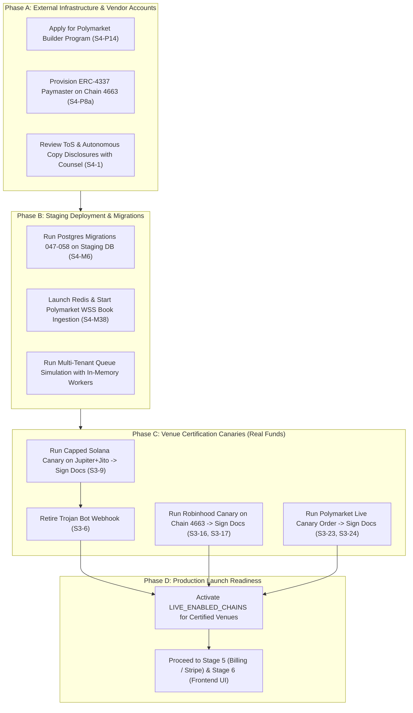

# Stage 1–4 Blockers, Deferred Items & External Gates Register

> **Status:** Active Reference & Audit Ledger  
> **Last Updated:** 2026-10-29  
> **Scope:** Comprehensive inventory of all open blockers, deferred tasks, external certification gates `(ext)`, and operational prerequisites across **Stage 1 through Stage 4**.

---

## 1. Executive Summary & Overview

Across Stages 1, 2, 3, and 4, the **code-level architecture and implementation are complete**:
- **Stage 1 (Auth & Multi-Tenancy):** Migrations `039`–`043`, SIWE/SIWS wallet authentication, layered auth tokens, CSRF protection, and strict `forUser(userId)` nominal tenancy isolation are implemented and 100% test-verified.
- **Stage 2 (Subscriptions & Quotas):** Migrations `044`–`045`, global wallet dedup with per-user subscriptions, concurrency-safe tier quotas (`SELECT FOR UPDATE`), and `/v1/me/*` routes are fully verified.
- **Stage 3 (Venue Executors):** The three execution adapters (Solana Jupiter+Jito, Robinhood EVM, Polymarket CLOB), queue isolation (`swat-trades-{solana,polygon,robinhood}`), and redemption state machines are fully implemented.
- **Stage 4 (Delegated Authority & Fan-Out):** The long pole of the architecture (**S4-P12**, Solana `wake-vault` Anchor program) has been developed, fuzzed, tested with real wallets, security-audited, and toggled live (`6t6dRetG3Hns4vCfZaj392e9bZ6uTEEmvL37KnDWErfS`). ERC-4337 argument-scoped permission policies, EntryPoint v0.7.0 pinning, paymaster spend limits, envelope encryption, and real-time Polymarket WSS orderbook streaming (`S4-M38`) are complete.

### The Distinction: Code Readiness vs. External Gates
The items remaining open are **NOT unwritten architectural blockers**. They fall into three specific categories:
1. **External Gates `(ext)`:** Live canaries requiring funded wallets, production venue accounts, and human sign-off.
2. **Operational / Third-Party Vendor Dependencies:** Signing up for the Polymarket Builder Program, provisioning an ERC-4337 bundler/paymaster key on chain 4663, and legal counsel ToS review.
3. **Cross-Service Wiring & Staging Deployments:** Running migrations on live containerized Postgres/Redis instances, and wiring frontend surfaces (Stage 6) to the completed backend endpoints.

---

## 2. Stage-by-Stage Blockers & Open Items

### 2.1 Stage 1 — User Accounts, Auth & Multi-Tenancy

**Stage Status:** Complete in code. All 43 core migrations applied clean, cross-tenant isolation suite passing (36/36).

| Item | Type | Title | Description & What Is Needed to Close |
|---|---|---|---|
| **S1-13 / S2-12** | Deferred (to Stage 6) | SSE Real-time Feed in UI (`/v1/me/stream`) | The backend SSE ticket authentication hook (`consumeSseTicket`) and stream exist in `apps/api/src/auth/sse-ticket.ts`. The client-side consumer was deferred to the Stage 6 frontend rebuild. |
| **S1-16 / S6-3** | Deferred (to Stage 6) | Deprecate Grandfathered `NEXT_PUBLIC_API_KEY` | `scripts/check-public-secrets.mjs` prevents any new client bundle leaks but grandfathers the legacy key until the Stage 6 frontend rebuild transitions all UI requests to session cookies / user API keys. |

---

### 2.2 Stage 2 — Per-User Tracking, Backfill & Attribution

**Stage Status:** Complete in code. Migrations `044`–`045` active, quota enforcement verified under concurrency, and disjoint multi-tenant feeds operating.

| Item | Type | Title | Description & What Is Needed to Close |
|---|---|---|---|
| **S2-13** | Non-blocking / Attribution | Polymarket Redemption Accounting in Attribution | `046_polymarket_redemptions.sql` and `apps/trade-executor/src/polymarket-redemption.ts` claim and reconcile winnings on-chain. Attribution reporting (`packages/db/src/pnl-queries.ts`) still needs explicit redemption event ingestion so resolved wins appear in historical copy P&L reports. |
| **S2-14** | Test Enhancement | Resolution-Aware Scoring Weight Golden Test | Add an end-to-end golden test asserting that Polygon/Polymarket scoring weights correctly adjust for time-to-resolution and outcome certainty. |
| **S2-15** | DB Hardening | Database-Enforced Expectancy Report Immutability | Make an immutable record in `expectancy_reports` a database constraint requirement before an operator script can alter scoring thresholds. |
| **S2-16** | Feature / Reporting | Per-Chain Score Evidence in API | Expose chain-specific metric breakdowns (DEX liquidity, wallet trade volume, cluster cohesion) in `/v1/me/signals/:id`. |
| **S2-17 & S2-18** | Regression Harness | Cross-Chain Signal Context & Active Dimension Suite | Add comprehensive multi-chain signal fixture tests ensuring every signal carries chain-native metadata and nightly reporting tests all modes. |

---

### 2.3 Stage 3 — Venue Executors & Certification

**Stage Status:** Execution engines and queue isolation (`S3-25`) built. Live mainnet certification requires funded operator accounts and canary trades.

#### A. Solana Leg (Jupiter + Jito Cutover)
| Item | Type | Title | Description & What Is Needed to Close |
|---|---|---|---|
| **S3-9** | **External Gate `(ext)`** | Capped Live Canary on Jupiter+Jito | Run a small trade with real SOL on the `jupiter-jito` path (using Jito tip and block engine), verifying idempotency and receipt reconciliation. Fill out and sign off [`docs/certification/solana.md`](file:///root/SWAT/docs/certification/solana.md). |
| **S3-6** | Operational Cutover | Retire Trojan Telegram Bot Webhook | Delete `TROJAN_WEBHOOK_URL`, `TROJAN_API_KEY`, and legacy Trojan execution paths once `S3-9` is certified. `handleJob` will then run exclusively on `jupiter-jito`. |
| **S3-8** | Performance Telemetry | Real-World Latency Distribution Verification | Measure webhook → signal → alert → execution latency over an active trading window to prove median execution stays under 60 seconds. |

#### B. Robinhood Chain Leg (Arbitrum Orbit — Chain ID 4663)
| Item | Type | Title | Description & What Is Needed to Close |
|---|---|---|---|
| **S3-10** | Configuration Pin | Verified Router ABI and On-Chain Address | Verify the exact deployed Uniswap V3 / SwapRouter contract address on chain 4663 and pin the ABI and bytecode hash. |
| **S3-13** | **External Gate `(ext)`** | Direction-Classification Sample (>95%) | Review a sample of real Robinhood Chain on-chain swaps against the scorer's buy/sell classification to confirm accuracy exceeds 95%. |
| **S3-14** | **External Gate `(ext)`** | Ingestion Completeness Review (>90%) | Verify the indexer captured >90% of target transactions against a reference block sample on chain 4663. |
| **S3-15** | Data Verification | Asset Holder Concentration Evidence | Confirm that holder concentration and liquidity verification queries operate reliably on Robinhood Chain tokens. |
| **S3-16** | **External Gate `(ext)`** | Robinhood Live Canary Scenarios | Execute a small live buy, a forced failure verifying signal claim release, and restart recovery of an orphaned receipt using a funded EOA on chain 4663. |
| **S3-17** | **External Gate `(ext)`** | Sign Off `docs/certification/robinhood-chain.md` | Complete operator review of [`docs/certification/robinhood-chain.md`](file:///root/SWAT/docs/certification/robinhood-chain.md) and formally add `robinhood-chain` to `LIVE_ENABLED_CHAINS`. |

#### C. Polygon / Polymarket Leg (CLOB & CTF)
| Item | Type | Title | Description & What Is Needed to Close |
|---|---|---|---|
| **S3-20** | Code Seam | Derive CLOB L2 Credentials from EVM Key | Derive Polymarket L2 HMAC credentials deterministically from the EVM signer instead of passing static environment credentials. |
| **S3-21** | **External Gate `(ext)`** | Authenticated Production Round Trip | Perform an authenticated API handshake against `clob.polymarket.com` and assert no secrets or private keys are emitted in application logs. |
| **S3-22** | **External Gate `(ext)`** | Compliance & Venue Terms Verification | Confirm operator account jurisdiction, venue terms compliance, and deposit wallet funding on Polygon. |
| **S3-23** | **External Gate `(ext)`** | Live Canary Scenarios | Execute a tiny filled BUY, an unfillable FAK order cancellation, and duplicate order rejection. |
| **S3-24** | **External Gate `(ext)`** | Sign Off `docs/certification/polygon-polymarket.md` | Operator sign-off of [`docs/certification/polygon-polymarket.md`](file:///root/SWAT/docs/certification/polygon-polymarket.md). |

#### D. Multi-Venue Isolation & Ops
| Item | Type | Title | Description & What Is Needed to Close |
|---|---|---|---|
| **S3-26** | Integration Test | Three-Chain Worker Fault Isolation (`F-ACC1`) | Provably demonstrate that an RPC outage on one venue (e.g. Solana congestion) does not stall or block concurrent execution on Robinhood Chain or Polymarket. |
| **S3-27** | Deployment Gate | Production Prerequisites Verification (`F-ACC3`) | Complete pre-deployment operational checklist: Postgres connectable, Redis reachable, Helius RPC active, API keys configured. |

---

### 2.4 Stage 4 — Delegated Authority, WAKE Vault, Multi-Tenant Fan-Out & Capacity

**Stage Status:** Complete in code. Smart contracts, adapters, encryption, policies, orderbook streams, and balance calculators are all implemented and verified. Remaining items are external legal review, vendor account provisioning, and live daemon integration.

#### A. Legal, Compliance & Governance
| Item | Type | Title | Description & What Is Needed to Close |
|---|---|---|---|
| **S4-1 / DG-2** | **External Gate (Legal)** | Counsel Opinion on Delegated Execution & ToS | **Non-negotiable legal launch gate.** Obtain legal opinion confirming that non-custodial delegated execution (PDA vault on Solana, ERC-4337 on EVM, deposit wallets on Polymarket) does not trigger money-transmitter or custodial VASP licensing. Publish ToS and copy-trading risk disclosures (inherent slippage, latency degradation). |
| **S4-P16** | Policy Review | Geo-Blocking & Unattended Execution Staleness | Verify that user IP is captured at interactive session consent time and that automated trades halt if the geo-verification timestamp exceeds the 7-day staleness window (`polymarket-geo.ts`). |

#### B. Solana Infrastructure (`wake-vault`)
| Item | Type | Title | Description & What Is Needed to Close |
|---|---|---|---|
| **S4-P12** | **COMPLETED** | Audited Anchor WAKE Vault Implementation | Program written, Decurity AST parsed, Soteria scanned, Trident fuzzed, tested against live Phantom/Solflare wallets, pre-funding PDA bug fixed, fee netting added, replay protection added, and live adapter toggled on (`6t6dRetG3Hns4vCfZaj392e9bZ6uTEEmvL37KnDWErfS`). |
| **S4-M21** | Infrastructure Optimization | Migrate Solana Detection from Webhooks to WSS | Transition Solana wallet detection in `apps/indexer` from Helius webhooks to LaserStream WebSocket on the Helius Developer plan ($49/mo) to cut detection latency by up to 200ms without gRPC cost. |

#### C. Robinhood Chain (ERC-4337 / EIP-7702)
| Item | Type | Title | Description & What Is Needed to Close |
|---|---|---|---|
| **S4-P10** | On-Chain Deployment | Deploy Permission Validator Module on Chain 4663 | The TypeScript rule engine (`permission-policy.ts`, 71 tests) and calldata decoder are complete. To achieve full Defense-in-Depth against an attacker bypassing our server, deploy the permission validator module to an Arbitrum Orbit testnet account and verify that a non-allowlisted `approve` reverts on-chain. |
| **S4-P8a** | Vendor Decision | Rialto Gasless Relayer vs Self-Hosted Paymaster | Evaluate Rialto’s `POST /gasless/submit` (feature ID 3) against running an Alchemy / ZeroDev paymaster on chain 4663. Price fee structures, rate limits, and latency implications. |
| **S4-M39 & S4-M40** | Address Resolution | Router & Permit2 Path Selection on Chain 4663 | Confirm whether swaps route through the native Uniswap V3 router or Rialto’s meta-aggregation router on chain 4663, and supply the verified contract addresses in `.env`. |
| **S4-2** | User Interface (Stage 6) | Interactive Session Key Grant Onboarding Flow | Build the frontend modal (Stage 6) where a user signs an EIP-7702 delegation or creates an ERC-4337 session key restricted to the approved router and expiration window. |

#### D. Polymarket (CLOB & Fan-Out Capacity)
| Item | Type | Title | Description & What Is Needed to Close |
|---|---|---|---|
| **S4-P14** | Vendor Account | Enroll in Polymarket Builder Program | Apply for official enrollment in the Polymarket Builder Program to obtain Builder API credentials for the production gasless relayer. |
| **S4-11** | User Interface (Stage 6) | Deposit Wallet Display & QR Code | UI screen displaying the user's dedicated Polymarket Deposit Wallet address with a copyable QR code. |
| **S4-M38** | Hot-Path Cutover | Trade Executor Local Orderbook Cutover | `apps/indexer` streams the WSS book into Redis and `signal-engine` reads it for fan-out capacity. The final optimization is updating `triggerPolymarket` in `apps/trade-executor/src/polymarket.ts` to read the pre-trade orderbook directly from the local Redis cache instead of making a REST `fetchOrderBook` HTTP call. |

#### E. Multi-Tenant Fan-Out, Sizing & Database State
| Item | Type | Title | Description & What Is Needed to Close |
|---|---|---|---|
| **S4-M6** | Staging Verification | Live Migration Replay & Multi-Process Integration | All migrations (`047`–`050`, `053`, `056`, `057`, `058`) and pure sizing/capacity modules (`per-user-sizing.ts`, `master-capacity.ts`) are built and unit-tested. Verify live DB execution by applying migrations to a staging Postgres database and running a multi-user fanout simulation. |
| **S4-M45** | Seam Completion | Solana & Robinhood Manual User Exit Endpoints | Polymarket manual exits and exit escalation ladders are fully implemented (`manual-exit.ts`, `polymarket-exit-race.ts`, 63 tests). Solana and Robinhood manual user exit endpoints are currently stubbed to fail closed with actionable error messages; implement their respective cancel/sell handlers when user-initiated manual emergency exits are required. |

---

## 3. Operational Roadmap to Resolve Remaining Items

---

## 4. Responsibility Matrix

| Area | Lead Role | Primary Files & Docs |
|---|---|---|
| **Legal & Regulatory** | Operator / Legal Counsel | [`docs/plans/stage-4-design.md`](file:///root/SWAT/docs/plans/stage-4-design.md) §Legal, `S4-1` |
| **Solana Canary & Jito** | Operator | [`docs/certification/solana.md`](file:///root/SWAT/docs/certification/solana.md), `apps/trade-executor/src/solana-dispatch.ts` |
| **Robinhood 4337 Setup** | Lead Engineer / Operator | [`packages/shared/src/authority/entrypoint.ts`](file:///root/SWAT/packages/shared/src/authority/entrypoint.ts), `packages/shared/src/authority/permission-policy.ts` |
| **Polymarket Builder Keys**| Operator | [`apps/trade-executor/src/polymarket-relayer-budget.ts`](file:///root/SWAT/apps/trade-executor/src/polymarket-relayer-budget.ts), `docs/adr/0003-delegated-execution-authority.md` §4 |
| **Staging DB & Migrations**| DevOps / Lead Engineer | `packages/db/sql/047_user_execution_grants.sql` through `058_copy_position_lots.sql` |
| **Frontend Rebuild (UI)** | Frontend Engineer | Stage 6 checklist (`S6-1` … `S6-47`) |
