# Wake Protocol — 20-Post X (Twitter) Build Progress Campaign

A staged, high-signal social campaign designed for Crypto Twitter / X. It translates the 6 build stages into a compelling narrative arc: moving from the core thesis, through deep infrastructure and non-custodial security, to live product features and early access.

---

## Campaign Schedule & Cadence

- **Frequency:** 1 post daily (or staggered across 3 weeks with 5 posts/week).
- **Tone:** Builder-centric, high-signal, technically rigorous, anti-vapourware.
- **Audience:** DeFi power users, on-chain traders, MEV researchers, protocol developers, and quantitative copy-traders.

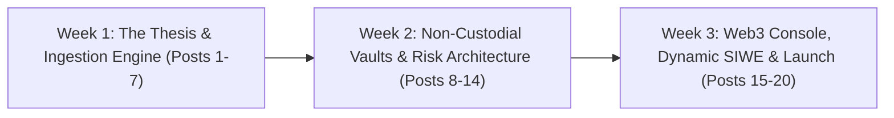

---

## Week 1: The Problem & Ingestion Engine

### Post 1: The Manifesto / The Gap Between Alpha and Action
- **Phase:** Announcement & Thesis
- **Hook:** Most crypto alert channels are useless. Here is why.

```text
Most Telegram signal bots are graveyards for your capital.

By the time an alert pings:
1. The insider already bought at block 0
2. Toxic MEV bots have sandwiched the liquidity
3. You buy the top of the candle

Alerts are passive. What DeFi actually needs is immediate, non-custodial execution.

Enter Wake Protocol. 🧵👇
```
- **Attached Media Asset:**
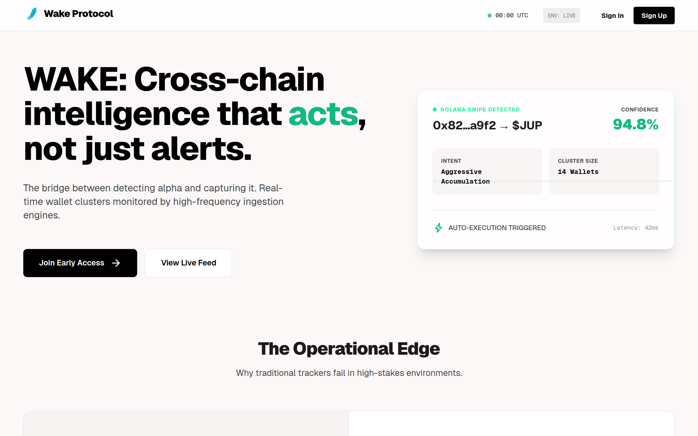

- **Follow-up Thread Tweet:**
```text
We spent the last few weeks engineering Wake Protocol from the bare metal up:
• Multi-chain ingestion across Solana, Robinhood Chain, & Polymarket
• Cluster intelligence that flags coordinated syndicates
• Zero-custody execution rails via Anchor PDAs & EIP-7702

Here is how we built it. 🛠️
```

---

### Post 2: Solving the Line-Speed Problem (Postgres BRIN + Redis Streams)
- **Phase:** Infrastructure Deep Dive
- **Hook:** How do you index hundreds of millions of on-chain transactions without setting your database on fire?

```text
How do you query 100,000,000+ on-chain transactions in milliseconds without choking your DB?

Standard B-Trees inflate to 40GB+ and eat all your RAM.

For Wake Protocol, we deployed PostgreSQL BRIN (Block Range Indexing) on block timestamps alongside Redis 7.4 streams.

The result:
⚡ 98% index storage reduction
⚡ Sub-10ms range scans across months of mempool data
⚡ Zero worker starvation under peak Solana block surges

Build for scale before you need it.
```
- **Attached Media Asset:**
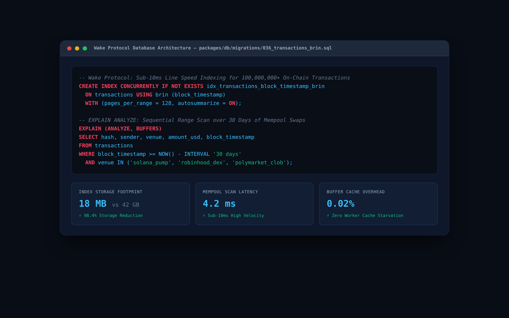

---

### Post 3: The Cross-Chain Reality (Solana, EVM, Polymarket)
- **Phase:** Architecture
- **Hook:** Alpha doesn't stay on one chain. Your execution engine shouldn't either.

```text
Alpha in 2026 isn't confined to a single ecosystem:

• Solana: High-frequency mempool velocity & sniper clusters
• Robinhood Chain (Arbitrum L2): Retail liquidity & sponsored execution
• Polymarket: Global macro odds & prediction market CLOBs

Most tools force you to run 3 separate dashboards.

Wake Protocol unifies all three into a single multi-chain execution engine with unified telemetry.
```
- **Attached Media Asset:**
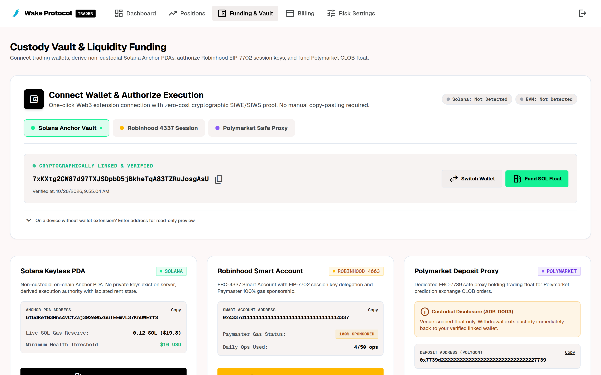

---

### Post 4: The Sybil Trap — Individual Wallets vs. Behavioral Clusters
- **Phase:** Intelligence Layer
- **Hook:** Tracking single "smart wallets" is dead. Syndicates use 30 burner wallets.

```text
Tracking a single "smart money" wallet address is a trap.

Top market makers and insider syndicates never trade from one address:
• They split capital across 20–50 fresh wallets
• They buy within the same 3-second block window
• They funnel profits through common funding hubs

Wake Protocol doesn't track addresses. It clusters behaviors.

Our clustering engine maps temporal correlation, shared funding trees, and simultaneous routing. You track the syndicate, not the sockpuppet.
```
- **Attached Media Asset:**
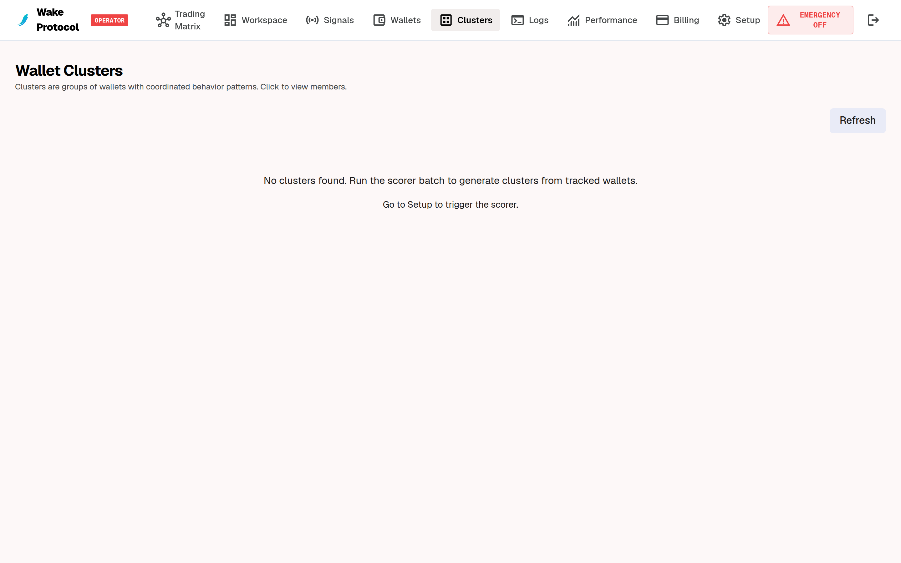

---

### Post 5: Defeating Toxic Sandwich Attacks on Solana (Jito MEV Bundles)
- **Phase:** Execution Layer
- **Hook:** Public mempool swaps on Solana are an open donation to MEV bots.

```text
If your copy-trading bot sends standard RPC transactions on Solana, you are getting sandwiched. Full stop.

Wake Protocol bypasses the public mempool entirely:
🛡️ Direct Jito Block Engine bundle submission
🛡️ Dynamic tip auctioning based on block congestion
🛡️ Atomic guarantee: the trade confirms in the bundle or not at all

No front-running. No back-running. No toxic slippage.
```
- **Attached Media Asset:**
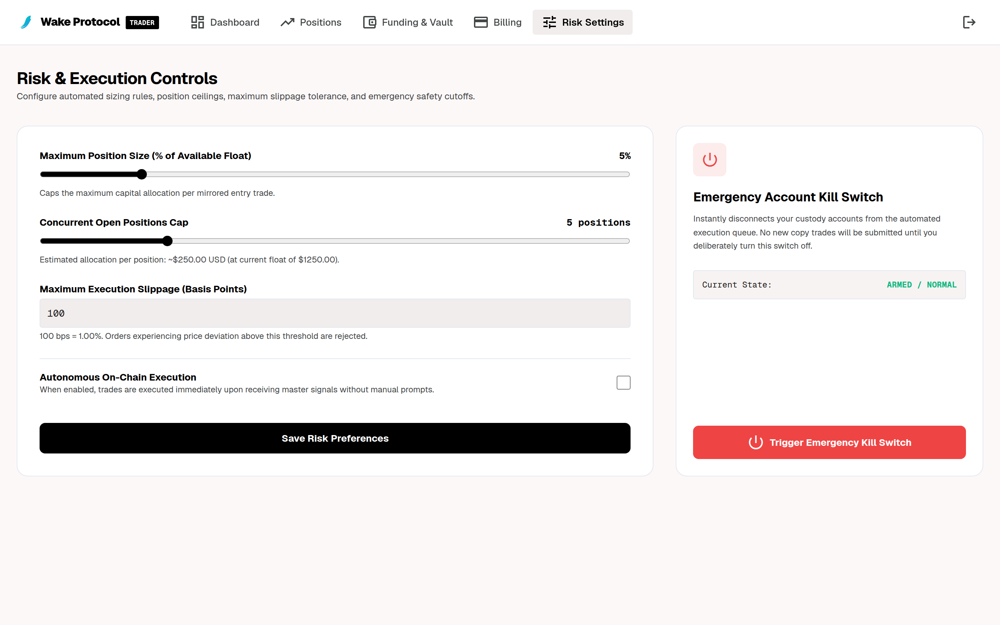

---

### Post 6: Early Buyer Discovery (The First 10 Minutes)
- **Phase:** Ingestion & Discovery
- **Hook:** Finding the alpha before Twitter finds out.

```text
Where do high-conviction wallets come from?

Our discovery daemon monitors Raydium, Pump.fun, and Uniswap pool creation events in real time.

When a fresh pool deploys:
1. Filters for early buyers entering within the first 10 minutes
2. Requires >0.5 SOL minimum skin-in-the-game (filters spam dust)
3. Grades their historical wallet win rate & profit retention

The engine continually seeds itself with newly discovered elite traders.
```
- **Attached Media Asset:**
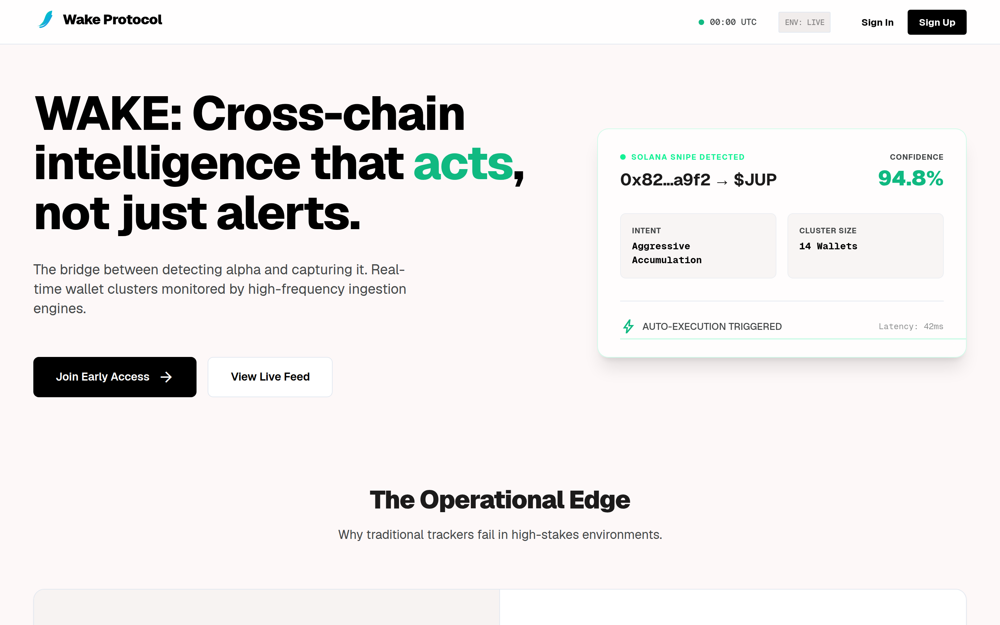

---

### Post 7: Daily Scorer Batch & The 3 Wallet Tiers
- **Phase:** Intelligence & Grading
- **Hook:** Past luck ≠ repeatable alpha. How we filter the noise.

```text
A trader who made 100x on one meme coin isn't a master trader. They got lucky.

Every night at 02:00 UTC, Wake Protocol runs an automated scoring batch over every tracked wallet:
• Realized ROI vs. Unrealized Drawdown
• Sharpe & Expectancy metrics
• Win rate across a minimum of 20 closed lots

Wallets are dynamically tiered:
🟢 Elite: High win-rate, disciplined sizing
🟡 Pro: Consistent momentum
⚪ Tracked: Under continuous telemetry

Follow only verifiable performance.
```
- **Attached Media Asset:**
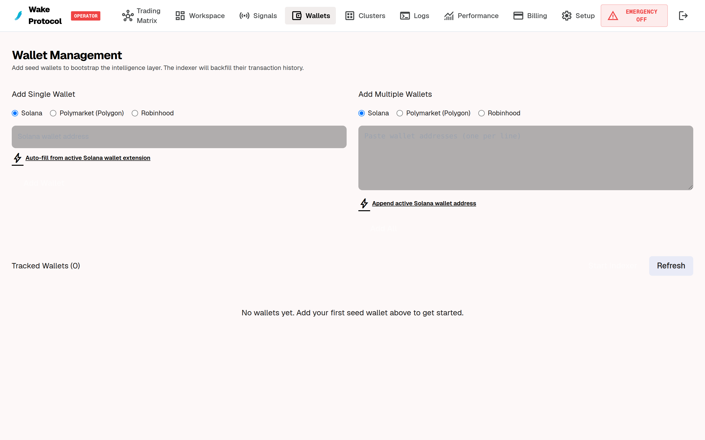

---

## Week 2: Non-Custodial Vaults & Risk Architecture

### Post 8: The Non-Custodial Golden Rule
- **Phase:** Custody Architecture
- **Hook:** "Give us your private keys so we can copy-trade for you" — Never again.

```text
The number one question we get:
"Do I have to export my private key to use Wake Protocol?"

The answer is absolute: NEVER.

Exporting your private keys to a third-party server is an architectural failure waiting for an exploit.

Wake Protocol uses 100% keyless, non-custodial custody rails:
• Solana: Isolated Anchor PDAs
• EVM: EIP-7702 Session Keys
• Polymarket: Isolated Safe Proxies

Your capital never leaves your cryptographic control.
```
- **Attached Media Asset:**


---

### Post 9: Under the Hood: Solana Anchor Keyless PDA
- **Phase:** Cryptographic Engineering
- **Hook:** How do you execute trades on Solana without the server having your keys?

```text
How does Wake Protocol trade on Solana without holding your keys?

Anchor Program Derived Addresses (PDAs):
`seeds = [b"wake_vault", user_public_key]`
`program_id = 6t6dRetG3H...`

Properties:
1. The PDA has NO private key on earth.
2. Only the smart contract can execute authorized swaps within pre-set slippage caps.
3. You hold the sole master authority: closing the vault returns all rent lamports and assets directly to your wallet.

Mathematical security > Promises.
```
- **Attached Media Asset:**


---

### Post 10: Robinhood Chain & EIP-7702 Account Abstraction
- **Phase:** EVM Engineering
- **Hook:** Gasless copy-trading on EVM using the newest Ethereum standard.

```text
EIP-7702 changes the game for EVM execution.

Instead of deploying heavy smart contract wallets, your existing EOA temporarily delegates execution rights to an ERC-4337 smart account:

✨ 30-Day Scoped Session: Only allowed to interact with vetted trading pairs
✨ 100% Gas Sponsorship: Wake Paymaster covers gas (no need to bridge gas tokens)
✨ Revoke Anytime: 1-click on-chain revocation kills the session instantly

No wallet migrations. Pure native Web3 UX.
```
- **Attached Media Asset:**


---

### Post 11: Polymarket Safe Deposit Proxies
- **Phase:** Prediction Market Execution
- **Hook:** Copy-trading prediction markets without custodial risk.

```text
Polymarket is the world's largest prediction exchange, but it doesn't support scoped signers out of the box.

Our solution: Isolated ERC-7739 Safe Deposit Proxies on Polygon.

• You deposit USDC into your dedicated Safe Proxy address
• Wake's CLOB executor submits matched limit orders
• Capital withdrawals are strictly whitelisted to your verified linked wallet

Venue-isolated liquidity with zero risk of cross-account contamination.
```
- **Attached Media Asset:**


---

### Post 12: The Capacity Cap Problem (Why 50 Followers is the Limit)
- **Phase:** Market Microstructure & Fairness
- **Hook:** Why popular copy-trading platforms silently front-run their own users.

```text
Ever wonder why public copy-trading platforms have terrible returns?

When 2,000 people copy the same whale:
1. The whale buys at $1.00
2. Follower #1 buys at $1.02
3. Follower #2000 buys at $2.10 (pumping the price for the whale)
4. The whale dumps at $2.00 into their own followers' bids.

Wake Protocol enforces a hard cap: MAX 50 COPIERS per master wallet.

We protect follower liquidity against pool depletion and slippage degradation.
```
- **Attached Media Asset:**
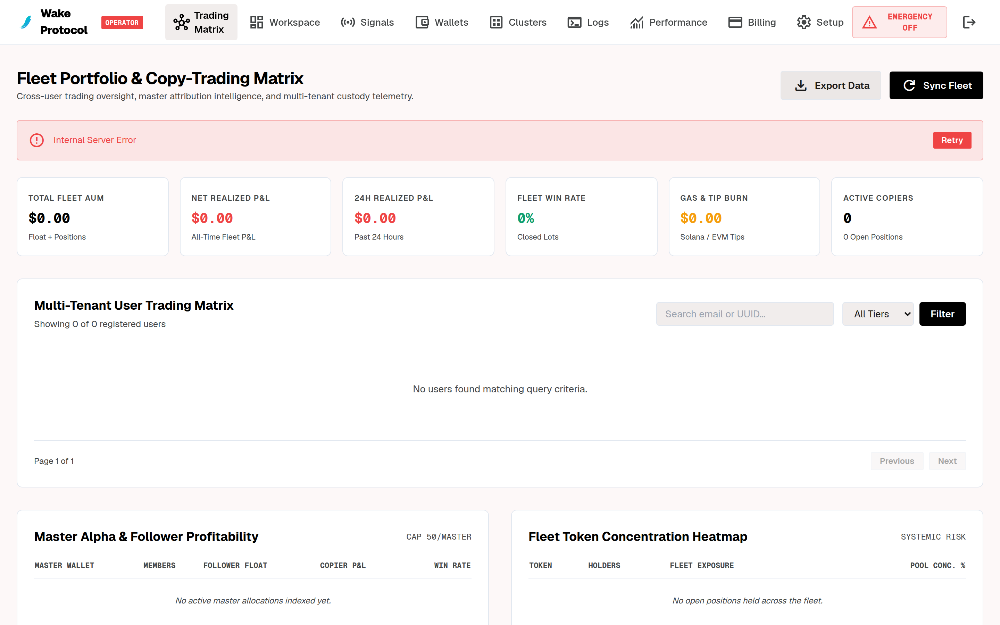

---

### Post 13: Lot-by-Lot Proportional Exits
- **Phase:** Trade Execution Logic
- **Hook:** What happens when a master wallet only sells half their position?

```text
Copy-trading isn't binary. Real whales scale out:
• Sell 25% at 2x
• Sell 35% on momentum break
• Leave 40% as a moonbag

How does Wake Protocol mirror this? Lot-by-Lot Attribution.

When the master sells 35%, the engine computes your specific entry lots and proportionally unwinds 35% of your position.

No stranded dust tokens. Exact mathematical attribution.
```
- **Attached Media Asset:**
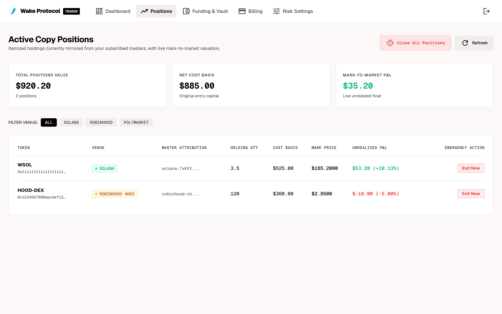

---

### Post 14: Autonomous Stop-Loss & Circuit Breakers
- **Phase:** Capital Preservation
- **Hook:** What if the whale gets rugged while sleeping?

```text
What happens if the master wallet you copy gets rugged, falls asleep, or makes a catastrophic mistake?

You don't go down with them.

Wake Protocol features an off-chain Autonomous Stop-Loss Engine:
🛑 Per-User Drawdown Cap: If a position drops >X%, auto-liquidate to USDC
🛑 Global Circuit Breaker: Halts copying if venue volatility exceeds safety thresholds
🛑 Slippage Guard: Orders abort if pool liquidity drops below execution minimums

Protecting your downside is rule #1.
```
- **Attached Media Asset:**


---

## Week 3: Web3 Console, Dynamic SIWE & Launch

### Post 15: The Global Emergency Off Switch
- **Phase:** System Reliability
- **Hook:** The red button every institutional platform needs.

```text
In high-frequency trading, your emergency shutoff must be absolute.

If an operator or trader triggers EMERGENCY OFF in Wake Protocol:
🚨 Broadcasts across Redis Pub/Sub in <2ms
🚨 Cancels all pending in-flight Jito and EVM transactions
🚨 Halts order dispatchers across all 3 venues instantly
🚨 Puts all follower accounts into capital preservation mode

Zero hesitation. Safety first.
```
- **Attached Media Asset:**
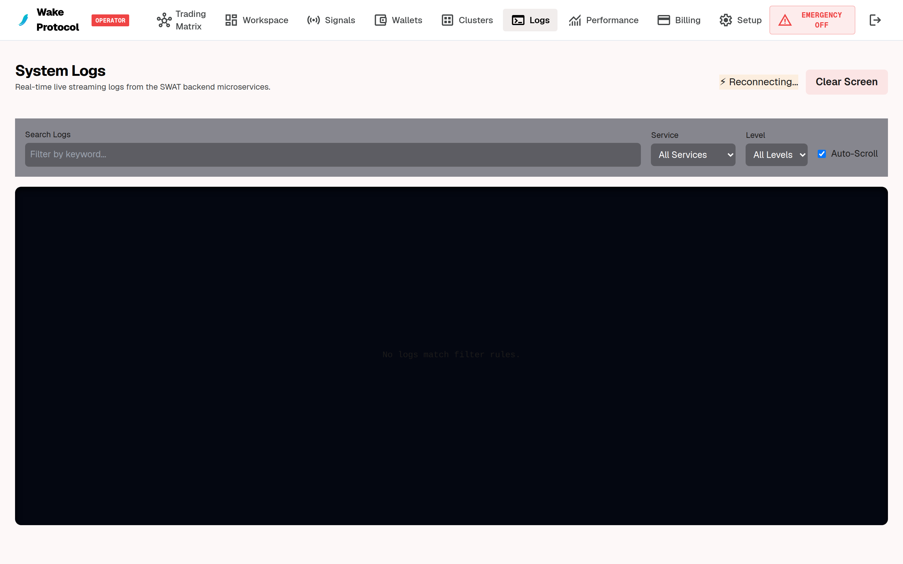

---

### Post 16: 1-Click Web3 Wallet Integration (No Copy-Pasting)
- **Phase:** Web3 UX
- **Hook:** Copy-pasting 0x and Solana addresses into text boxes is archaic.

```text
Web3 UX should feel like Web3, not an Excel spreadsheet from 2004.

We completely redesigned the Wake Protocol custody vault:
⚡ 1-Click Phantom, Solflare, & Backpack integration (Solana)
⚡ 1-Click MetaMask, Rabby, & Coinbase Wallet integration (EVM)
⚡ Automatic Polygon network switching for Polymarket
⚡ Zero address pasting: instant cryptographic signature verification

Connect, sign once, and your execution vault is live.
```
- **Attached Media Asset:**
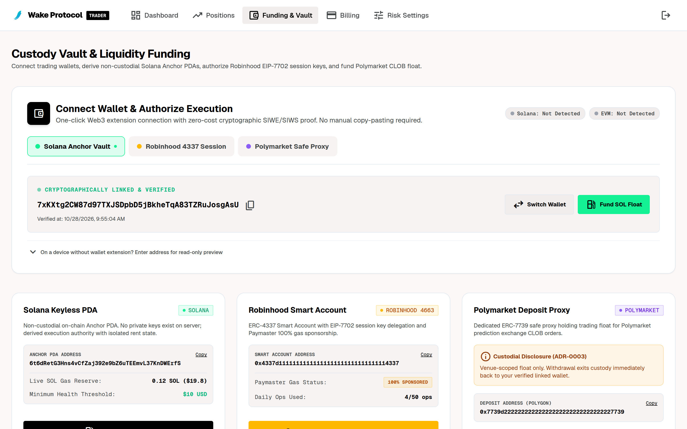

---

### Post 17: Fixing the "Domain Mismatch" Security Bug
- **Phase:** Cryptographic Engineering
- **Hook:** Ever had MetaMask or Phantom flash a scary "Deceptive Request" warning? Here's why and how we fixed it.

```text
Ever had MetaMask warn you with a red screen:
"Deceptive Request: Domain mismatch"?

It happens when the backend hardcodes an auth domain (e.g., localhost) in the SIWE/SIWS challenge message that doesn't match the user's active tab.

We engineered dynamic SIWE/SIWS binding:
• Challenges dynamically match the caller's origin & host
• Atomically consumed in Redis via GETDEL (zero replay attacks)
• Smooth, warning-free signature popup in Phantom and MetaMask

Security without breaking user trust.
```
- **Attached Media Asset:**
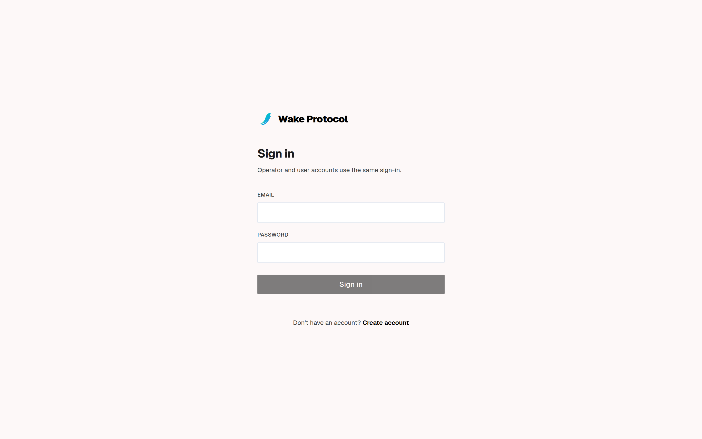

---

### Post 18: Operator Matrix vs. Trader Console
- **Phase:** Product Architecture
- **Hook:** One protocol. Two dedicated command centers.

```text
Wake Protocol is built with role-adaptive command centers:

👨‍💻 Operator Console:
• Fleet-wide portfolio & AUM telemetry
• Systemic token concentration heatmaps
• Live streaming microservice log terminals
• Direct cluster scoring & wallet backfilling

📊 Trader Console:
• Non-custodial liquidity vault
• Real-time copy execution feed
• Granular slippage & position sizing limits
• 2FA email security for withdrawals

Purpose-built interfaces for both operators and followers.
```
- **Attached Media Assets:**

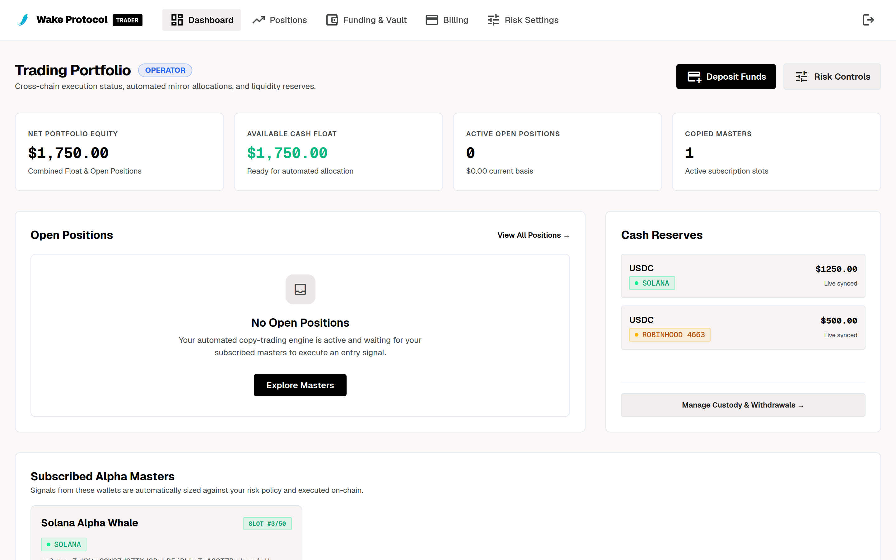

---

### Post 19: Subscription Tiers & Real Crypto Billing
- **Phase:** Monetization & Commercials
- **Hook:** No credit cards. No KYC. Native USDC crypto billing.

```text
Software subscriptions shouldn't require Stripe forms or bank accounts.

Wake Protocol runs on native on-chain USDC subscriptions:
🔹 Starter: Free view-only signals and discovery
🔹 Operator ($99/mo): 5 copy slots, 50 sponsored ops/day, priority execution
🔹 Ultra ($499/mo): 50 copy slots, unlimited sponsored ops, private Jito lanes
🔹 Lifetime ($4,999): Permanent institutional access

Instant on-chain verification. Zero chargebacks.
```
- **Attached Media Asset:**
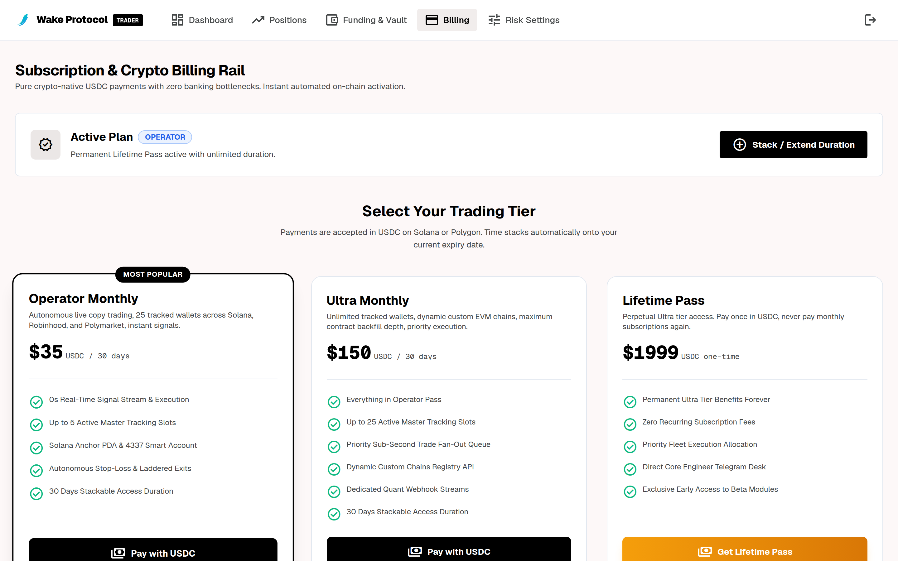

---

### Post 20: The Official Launch / Early Access Invitation
- **Phase:** Launch Call-to-Action
- **Hook:** Cross-chain intelligence that acts. We are live.

```text
The wait is over. Wake Protocol is live.

From real-time mempool clustering to keyless non-custodial copy-trading across Solana, Robinhood Chain, and Polymarket:

We built the bridge between detecting alpha and capturing it.

👉 Early Access is now open: [LINK]
👉 Read our technical documentation: [LINK]

Stop watching alerts. Start executing. 🌊⚡
```
- **Attached Media Asset:**

